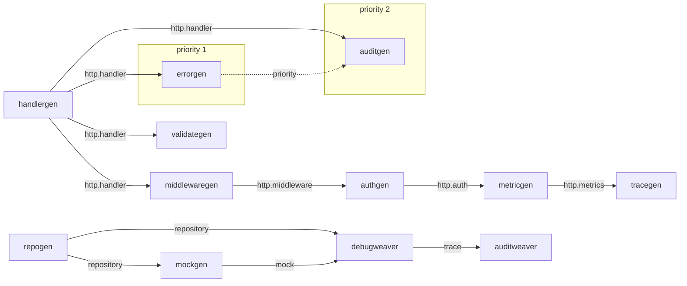

<!--
  ~ Copyright Dokimasia B.V. 2026
  ~ SPDX-License-Identifier: Apache-2.0
-->

# RFC-0026: The reference ensemble and the canary ring

## Summary

The module `eidos-reference` gets nineteen reference plugins, the binary
`eidos-reference` and a workspace tree. The plugins import the SDK facade.
Together they use each way in which one plugin builds on another: a host
with named slots, contributors that fill them, weavers, annotators whose
facts other plugins read, plugins with an annotator half and a generator
half, claimed file templates, test families and options. The binary
composes the plugins into a Go plan and a TypeScript plan. The acceptance
suite runs the binary. The workspace suite and the warm suite run over the
tree, and the Go toolchain builds the Go output and runs the tests that the
plugins generate.

CI builds every module of the workspace against the kernel at the commit,
and the release job publishes a commit only after CI passed on the same
content. So the canary ring at kernel HEAD does not need a new check. A
ring job adds the published versions of the ring's modules, which it builds
against the kernel at HEAD.

Outside the module, the design changes the kernel and the specification:

- The scaffolding vocabulary gets `ExprRef`, a reference to a declaration
  of another package, which the target qualifies and imports. A
  contributor needs it to append a call such as `errors.Recover(w, r)` to
  a handler.
- The specification drops its benchmark checks, because a release of the
  project does not wait on a benchmark run.

## Motivation

### The canary has no code

The compatibility policy makes eidos-reference the designated canary of
the ring, kept API-typical on purpose. The module's one Go file is its
package comment, so the ring does not have its canary to run.

The conformance fixtures each test one mechanism, with a small plugin that
the test builds: a stub generator, a registrar and an audit weaver.
eidos-plugin-shape is one family of annotators. Neither composes a host
with its contributors, weavers and annotators in one run, with plugins
that depend on each other through facts, capabilities and named slots. A
change of the facade that breaks such a composition passes the fixtures
and the catalog.

### The design of the canary found a gap

The rendering specification describes a cross-cutting plugin that appends
an audit call into the body of another plugin's handler. The scaffolding
vocabulary has three expressions:

- A name, which the target writes as it is, without an import.
- A call, which applies an expression to arguments.
- A value, which can call a function of another package by its identity
  and import it. The arguments of such a call are values.

So the vocabulary does not have an expression for a call such as
`audit.Record(w, r)`, which passes the handler's parameters. A plugin that
needs such a call today writes raw text in one language, or claims the
whole body with a template. Raw text and a claimed body do not compose in
a slot, and five of the nineteen plugins of this design append such a
call.

### The specification describes checks that the project does not run

A release of the project does not wait on a benchmark run. Each package
pins the allocation ceilings of its hot paths in its benchmarks and its
Allocs tests. The benchmarking specification still describes a corpus
generator, a scenario matrix, budgets with baselines on a dedicated runner,
and a comparison with the previous release that blocks the tag. It also
makes eidos-reference the performance rig of the ring. A reader of the
specification would build checks that the project does not want.

## Detailed design

### Components

| Component | Where | Change |
|---|---|---|
| The ensemble | `eidos-reference/<plugin>`, nineteen packages | new |
| The composition | `eidos-reference`, package `reference` | `Compose` |
| The binary | `eidos-reference/cmd/eidos-reference` | `main` over `cli.Main` |
| The workspace tree | `eidos-reference/testdata/tree` and `testdata/want` | new |
| The reference expression | `core/emit`, `lang/scaffold`, `core/plugin` | `ExprRef` |
| The import rule | `.ergon/local/.golangci.yml` | depguard covers the plugin packages of eidos-reference |
| The ring job | `eidos-reference/internal/ring` and `.ergon/local/.github/workflows/ci.yml` | new |
| The specification | rendering, compatibility, benchmarking, decisions, README | edited |

### Invariants

1. A plugin of the ensemble imports the SDK facade. A plugin whose output
   is Go alone may also import the Go satellite. A plugin does not import
   the kernel. It imports another plugin of the ensemble only for an
   exported name: a key, a capability, a slot or a parameter.
2. Every plugin passes `plugintest.RunPluginSuite` without
   special-casing.
3. The ensemble uses only what a consumer outside the repository can use.
   It does not use an internal package of the kernel or a test hook.
4. The Go output of the workspace builds and passes `go vet`, and the
   tests that the plugins generate pass under `go test`. The TypeScript
   output passes `tsc`.
5. `workspacetest.RunWorkspaceSuite` and `RunWarmColdSuite` pass over the
   tree.
6. The binary passes `acceptancetest.RunAcceptanceSuite`.
7. A release publishes a commit only after the ring passed on its
   content.
8. A plugin that extends the output of another plugin requires that
   plugin's capability.

### The brand and the directives

Under the brand `reference`, a carrier is `//+reference:<name>`, the config
file is `.reference.yaml`, and the state directory is `.reference/`.

| Directive | Plugin | On | Params | The negated form |
|---|---|---|---|---|
| `handler` | handlergen | struct | none | refused |
| `repo` | repogen | struct | none | refused |
| `mock` | mockgen | interface | none | refused |
| `stub` | stubgen | interface | none | refused |
| `register` | registrygen | struct | none | refused |
| `audit` | auditweaver | struct, interface | none | refused |
| `writer` | shapewriter | struct | none | excludes the struct from the heuristic |
| `default` | defaults | field | the value, positional and required | refused |
| `builder` | builder | struct | `defaults`, a reference that resolves to a callable in scope | refused |
| `enum` | enum | enum | `methods`, a bool | refused |
| `text` | enum | constant | the text, positional and required | refused |

The kernel's `skip` directive excludes a subject from the bare and
fact-gated rules of one plugin, as `skip plugin=mockgen` does in the tree.
debugweaver and sentinel do not declare a directive of their own, so `skip`
is the way to exclude a subject from their rules.

### The ensemble

Each plugin is one package under `eidos-reference`, named after the plugin.
Its handlers read the source side through their match and emit neutral
values. A body that the scaffolding vocabulary cannot express is a template
reference in the plugin's tree.

The workspace schedules each generator as a bucket of its own, ordered by
priority, then by capability topology, then by name. An `OnEmit` rule sees
only the values that earlier buckets placed. So each plugin that extends
the output of another plugin requires that plugin's capability, and the
name order never decides whether a host ran first. The contents of one slot
follow the same schedule.



A solid arrow runs from the plugin that provides a capability to the
plugin that requires it. The dotted arrow is the order of two priorities.
Every generator outside the two subgraphs has priority 0.

#### The HTTP handler and its contributors

The plugins of this table compose one handler and one middleware function
for each struct under `handler`. Their output is Go alone, because its
types come from `net/http`.

| Plugin | Rules | Writes | Order |
|---|---|---|---|
| handlergen | `handler` on a struct, as an annotator and as a generator | the fact `handlergen.handler`; `<T>Handler` and its `ServeHTTP` into the family `handler` | provides `http.handler` |
| middlewaregen | `Where(handlergen.handler)` on a struct | `<T>Middleware(h)` with the named body slot `chain`, into the family `middleware` | provides `http.middleware`, requires `http.handler` |
| authgen | `Where(handlergen.handler)` on an emitted function | `h = <package>.<func>(h)` into `chain` | provides `http.auth`, requires `http.middleware` |
| metricgen | as authgen | as authgen | provides `http.metrics`, requires `http.auth` |
| tracegen | as authgen | as authgen | provides `http.trace`, requires `http.metrics` |
| validategen | `Where(handlergen.handler)` on a struct, and on an emitted method | `Validate<T>(r)` into the family `validate`, and a guarded call into the prologue of `ServeHTTP` | provides `http.validate`, requires `http.handler` |
| errorgen | `Where(handlergen.handler)` on an emitted method | `<package>.<func>(w, r)` into the epilogue of `ServeHTTP` | priority 1, provides `http.error`, requires `http.handler` |
| auditgen | as errorgen | as errorgen | priority 2, requires `http.handler` |

handlergen promotes its conclusion to the fact `handlergen.handler`. The
seven other plugins select their subjects through
`Where(HasKey(meta.Named[bool](handlergen.KeyHandler)))`, and they do not
read handlergen's directive.

The chain renders auth, metrics and trace whatever the order of the
composition's list, because each contributor requires the one before it.
errorgen and auditgen order their two calls through two priorities. A
contributor whose option `package` or `func` is empty reports an Error at
the subject and appends nothing, because the option contract of a plugin
has no required key.

`ServeHTTP` has the fixed composition of a body: the prologue, the
content, the named slots and the epilogue. middlewaregen's content has to
follow its named slot. So its body is the template `middleware.tmpl`,
which places `{{slot "prologue"}}`, `{{slot "chain"}}`
and `{{slot "epilogue"}}` before `return h`. The contributors find the
slot through `Body.Slot(middlewaregen.ChainSlot)`. A function without the
slot, such as the validator, reports false, and the contributor then
appends nothing to it.

For the struct `Orders` in `orders.go`, with the options of the tree, the
Go plan writes `orders_handler.go`:

```go
// OrdersHandler serves Orders over HTTP.
type OrdersHandler struct {
    Orders *Orders
}

// ServeHTTP calls Serve between the statements that other plugins
// contribute.
func (o *OrdersHandler) ServeHTTP(w http.ResponseWriter, r *http.Request) {
    err := ValidateOrders(r)
    if err != nil {
        return
    }
    o.Orders.Serve(w, r)
    errors.Recover(w, r)
    audit.Record(w, r)
}
```

It writes `orders_middleware.go`:

```go
// OrdersMiddleware wraps h in the middleware of Orders.
func OrdersMiddleware(h http.Handler) http.Handler {
    h = auth.RequireAuth(h)
    h = metrics.RecordLatency(h)
    h = trace.StartSpan(h)
    return h
}
```

It also writes `orders_validate.go`:

```go
// ValidateOrders reports whether the request for Orders is well-formed.
func ValidateOrders(r *http.Request) error {
    return nil
}
```

The consumer writes the method `Serve` on `Orders`, so the hand-written
code refers to the source type alone. A method on the generated type would
refer to a declaration that the frontend never loads, because a load skips
the files that the manifest records as generated. Each contributor reads
the package and the name of its callee from its options. The tree declares
the callees in `httpmw/`.

#### Repositories, doubles and weavers

| Plugin | Rules | Writes | Targets | Order |
|---|---|---|---|---|
| repogen | `repo` on a struct, as an annotator and as a generator | the fact `repogen.repository`; `<T>Repository` and `<T>Repo` into the family `repo` | Go | provides `repository` |
| mockgen | `mock` on an interface, and every interface that the plan emits | `<I>Mock` into the family `mock` under the tag `test` | Go, TypeScript | provides `mock`, requires `repository` |
| stubgen | `stub` on an interface | `<I>Stub` and a call record for each method into the family `stub`, and the claimed test file of the tag `test` | Go, TypeScript | provides `stub` |
| registrygen | `register` on a struct | the records of the claimed file of the family `registry` | Go | none |
| debugweaver | `Where(repogen.repository)` on an emitted method | `<package>.<func>(<format>, "<T>.<M>")` into the prologue | Go | provides `trace`, requires `repository` and `mock` |
| auditweaver | `audit` on the origin of an emitted method | as debugweaver | Go | provides `audit`, requires `trace` |

A return of scaffolding writes one value, and `Get` returns two. So
repogen's struct methods have the template body `repo.tmpl`, which places
the slots and returns the zero values of the method's results.

In mockgen and stubgen, each body calls through the receiver, which the Go
target writes as `m.GetFunc` and the TypeScript target as `this.getFunc`.
So each of the two plugins declares a template tree for each target
through `For(target, Templates(tree))`. In TypeScript, the function fields
of a mock and of a stub are optional, because `tsc` under `strict` refuses
a class field without an initializer. mockgen's rule over emitted
interfaces is bare, and `skip plugin=mockgen` on the origin of an
interface excludes it.

In Go, the test file of a stub contains `var _ Store = (*StoreStub)(nil)`
and one test for each method. Each test installs the function field, calls
the method, and checks that the stub recorded one call. In TypeScript, the
file contains `const check: Store = new StoreStub();`, which `tsc` checks.
The Go target writes a value conversion as `*StoreStub(nil)`, without the
parentheses that a pointer type needs. So stubgen's test family claims its
files with the template `stub.test.tmpl` instead of emitting a variable.

Each struct under `register` adds one record to the claimed file of the
family `registry`. The template `registry.tmpl` writes one `func init()`
for each file, with one call for each record, and records the import of
the callee through `use`. A declared `func init()` for each struct would
repeat one name in a package, and the settle checks the names of a package
for collisions. Records do not take part in that check.

The weavers skip a method without a receiver, because the methods of an
interface do not render a body. debugweaver weaves every method that the
plan emits from a repository subject: the methods of `<T>Repo`, and the
methods of the mock of `<T>Repository` where mockgen writes one.
auditweaver weaves the methods of each subject under `audit`. Where both
weave one method, the requirement on `trace` renders the trace first:

```go
// Get implements ProductRepository with zero values.
func (p *ProductRepo) Get(ctx context.Context, id string) (*Product, error) {
    log.Printf("debug: %s entered", "Product.Get")
    log.Printf("audit: %s", "Product.Get")
    return nil, nil
}
```

#### Annotators

| Plugin | Rules | Stamps | Targets |
|---|---|---|---|
| shapewriter | a bare rule on a struct, and `writer` on a struct | `shapewriter.writer` | Go |
| defaults | `default` on a field, then a bare rule on a field | `defaults.value` and `defaults.source` | the directive in every language, and the tag in each language whose rules implement `rules.TagRules` |

shapewriter stamps `shapewriter.writer` on a struct that declares a method
`Write` with one `[]byte` parameter and the results `int` and `error`. A
method that an embedded field promotes does not count.
`+reference:writer` stamps the fact on a struct without such a method.
`-reference:writer` excludes a struct from the heuristic. The fact store
reads the absence of a fact as false, so the plugin stamps only true.

defaults stamps the text of a declared default, as the sample annotator
stamps the text of a sample. A reader turns the text into a value through
the rules of the subject's language. The bare rule reads the tag under the
option `tag`, which is `default` unless a config sets it, through the
language's `rules.TagRules`. Within one plugin, the first claim in rule
order takes precedence. The directive rule comes first, so on a field with
both forms the directive's value becomes the fact.

#### Builder, enum and sentinel

| Plugin | Rules | Writes | Order |
|---|---|---|---|
| builder | `builder` on a struct | `<T>Builder`, `New<T>`, `New<T>From` and the setters into the family `builder`, and the claimed test file of the tag `test` | requires `defaults` |
| enum | `enum` on an enum, `text` on a constant | `String`, `IsValid`, `MarshalText` and `UnmarshalText` on the enum type, `Parse<T>`, `<T>Values` and `ErrUnknown<T>` into the family `enum`, and the claimed test file of the tag `test` | none |
| sentinel | a bare rule on a variable, as an annotator; `Where(sentinel.value)` on a variable and `Where(golang.satisfiesError)` on a struct, as a generator | the fact `sentinel.value`; the records of the claimed test file of the family `sentinel` | none |

All three write Go alone, and the tests that they write import the
standard library alone.

builder picks the setters of a member by the form of its type: a scalar, a
sequence, bytes, a set, a mapping or an optional. The setters and the
constructors have template bodies. The constructor seeds each field that
has a declared default. A function under the `defaults` param, which the
directive resolves as a callable in scope, seeds the whole value first.
The test file takes its samples from the kernel's sample and witness
facts.

enum adds methods to the source type. It withholds a method that the type
declares already, and it writes `Parse<T>` and `<T>Values` only where it
writes `String`. A variant's text is its declared string, or its name
without the prefix of the type, and `text` on the constant replaces it.
When two variants have the same text, enum reports the second variant and
does not write anything for the type.

The annotator half of sentinel stamps `sentinel.value` on each variable
whose name the language's `rules.ErrorValueRules` accepts. The generator
half selects its variables through that fact, so its handlers do not
filter their subjects. For each package, the test file checks these
properties:

- Each sentinel has a message, and the message starts with the prefix of
  the package.
- Each message differs from every other and does not start with another.
- A sentinel does not match another under `errors.Is`.
- Each error type reports a message for its zero value, and exposes the
  cause that it was given.

The option `prefix` replaces the package's name. The value `off` removes
the check of the prefix.

### The composition and the tree

The package `reference` declares the composition in three parts, because
the workspace suite takes a composition without its plans and the plans
apart:

```go
// Base returns the composition of eidos-reference without its plans: the
// brand reference, the Go and the TypeScript frontends and rules, the
// targets golang and typescript, the annotators shapewriter and defaults,
// and parallel dispatch on four workers. Each call returns new plugin
// instances.
func Base() *workspace.Builder

// Plans returns the two plans. The plan go reads the Go packages of the
// tree and runs every generator of the ensemble toward the Go backend.
// The plan typescript reads the TypeScript sources under web and runs
// mockgen and stubgen toward the TypeScript backend. Each call returns new
// plugin instances, and one instance of mockgen and of stubgen serves both
// plans.
func Plans() []workspace.Plan

// Compose returns Base with Plans: the composition of the binary.
func Compose() *workspace.Builder
```

```go
func main() { cli.Main(reference.Compose) }
```

handlergen, repogen and sentinel are listed once, in the plan go. The
workspace schedules a plugin that implements both roles as an annotator
too, and a second instance under one name fails Build.

A double of a Go interface in a TypeScript file would refer to a Go
declaration that the TypeScript plan does not emit. So the TypeScript plan
reads TypeScript sources, and each of its doubles implements an interface
of the same language.

```text
testdata/tree/
    .reference.yaml       the options of the contributors and the weavers
    go.mod                example.com/shop
    orders/orders.go      Orders under handler, and its method Serve
    catalog/product.go    Product under repo and audit
    catalog/review.go     Review under repo, and under skip for mockgen
    catalog/address.go    Address under builder, with declared defaults
    catalog/store.go      Store under stub and mock
    catalog/status.go     Status under enum
    catalog/errors.go     ErrNotFound, ErrConflict and NotFoundError
    catalog/sink.go       Sink, whose Write method shapewriter detects
    catalog/item.go       Item under register
    httpmw/               auth, metrics, trace, errors and audit
    web/store.ts          Store under stub and mock
    web/tsconfig.json
testdata/want/            every file that the two plans write
```

The config of the tree sets the options of the five contributors:

```yaml
version: 1
options:
    authgen: {package: example.com/shop/httpmw/auth, func: RequireAuth}
    metricgen: {package: example.com/shop/httpmw/metrics, func: RecordLatency}
    tracegen: {package: example.com/shop/httpmw/trace, func: StartSpan}
    errorgen: {package: example.com/shop/httpmw/errors, func: Recover}
    auditgen: {package: example.com/shop/httpmw/audit, func: Record}
```

The edit of the workspace suite renames a parameter of a method of `Store`
in `catalog/store.go`. The double that the plan `go` generates changes. The
plan's export does not change, because an export entry does not list
parameters.

### Tests

- Each plugin's package runs `plugintest.RunPluginSuite` over a fixture
  that `load.Load` builds from the tree.
- The package `reference` compares a cold run with `testdata/want` through
  `golden.MatchAt`, and runs `RunWorkspaceSuite` and `RunWarmColdSuite`
  over the tree.
- The same package lays out the Go output with the tree and runs
  `gotesting.AssertVets` and `toolchain.AssertTestsPass`. It type-checks
  the TypeScript output through the TypeScript adapter.
- The same package reads the facts of a run, and asserts the stamps of
  shapewriter and defaults.
- `cmd/eidos-reference` runs `acceptancetest.RunAcceptanceSuite` over the
  binary.

### The reference expression

```go
const (
    // ExprName, ExprCall and ExprValue are unchanged.

    // ExprRef refers to a function, a constant or a variable that another
    // package declares, by its identity. The target qualifies the name for
    // the file that it is written into and records the import, as it does
    // for the callee of a ValueCall. As the Fn of a call, it calls the
    // function with the call's arguments.
    ExprRef
)

type Expr struct {
    // Kind, Name, Fn, Args and Val are unchanged.

    // Ref identifies the declaration of an ExprRef. It is populated on
    // ExprRef alone.
    Ref symbol.Identity `json:"ref,omitzero"`
}

// RefExpr returns an expression that refers to a declaration of another
// package.
func RefExpr(id symbol.Identity) Expr
```

- The shared scaffold of the C-family targets writes an `ExprRef` through
  `Target.Callee`. Go, TypeScript, Java and Rust implement `Callee`
  already, for the callee of a value call.
- The scaffold returns an error for an `ExprRef` whose identity has no
  name, and for an `ExprRef` without a target.
- The settle leaves an `ExprRef` as written, because the target spells the
  identity. A name in one of the plan's own packages is an `ExprName`,
  which the settle follows.
- `ExprKind.String` returns `ref` for the kind, and the backend suite adds
  an `ExprRef` to its canonical fixture.
- The SDK facade re-exports the kind and `RefExpr` on regeneration.

### The ring

Every CI run builds and tests each module of the workspace against the
kernel at the commit, eidos-reference, eidos-plugin-shape and the
satellites among them. The verify step of the release job lets a commit
publish only after a CI run passed on the same content. So a failure of
the ring at kernel HEAD already blocks the tag, and this design does not
add a check for it.

The ring job adds the published side. `internal/ring` is a Go program in
the reference module:

1. It lists the ring's modules from `go.work`: each module that requires
   the kernel, the kernel and the SDK facade excepted. The list grows with
   the workspace, so eidos-cli, eidos-declarative and a new satellite join
   the ring without an edit.
2. For each module, it reads the latest published version from the module
   proxy, as `go list -m -json <module>@latest` does.
3. For a published module, it writes a scratch module that requires that
   version and replaces the kernel and the SDK facade with the checkout.
   It then runs `go test` over the packages of the published module.
4. It reports a module without a published version as unpublished, and it
   does not run a test for such a module. CI tests its workspace version
   already.
5. It exits with a failure when any module fails.

`ergon init sync` merges the job from
`.ergon/local/.github/workflows/ci.yml` into `ci.yml`. A ring failure then
fails the CI run that the release job reads. The program's own tests run
it against a file proxy. The proxy serves one fabricated version of a
module whose test fails against the checkout.

### The specification

| Document | Change |
|---|---|
| Rendering | The scaffolding vocabulary has four expressions, and a reference refers to a declaration of another package |
| Compatibility | Before a module's first publication, the ring tests its workspace version. The release does not publish benchmark results |
| Benchmarking | The document keeps the allocation contract of the micro benchmarks and the probe of zero work. It drops the corpus generator, the scenario matrix, the scaling, absolute-time and memory gates, the budgets file and the comparison with the previous release. eidos-reference is the canary and does not run a benchmark |
| Decisions | A new row supersedes the row on benchmark gating: a release does not wait on a benchmark run, and each package pins its allocation ceilings. A new row records the ensemble as the canary |
| README | The row of eidos-reference describes the ensemble, the binary and the tree |

## Alternatives considered

### Emit kinds that a plugin defines

A plugin declares its own emit kinds, such as a handler with its own
slots, a middleware stack and a registration. It provides the template
that renders each kind. Contributors append values of their own kinds into
a host's slots, and the render runs the template of each value's kind.

**Why not:** the schema generates the emit kinds as a closed set, and each
backend renders each kind of the set. The template lint, the slot
declarations of the schema, the import collection of a backend and the
refusals that a backend declares cover these kinds alone. A plugin that
needs output outside them claims a body or a file, and the kernel has both
claims.

### The conformance fixtures as the canary

The ring runs the conformance fixtures. They already build a small plugin
for each mechanism.

**Why not:** each fixture tests one mechanism alone. The canary has to
compose hosts, contributors, weavers and annotators that depend on each
other through facts, capabilities and named slots, the way a product
composes them.

### builder, enum, sentinel and defaults in dokimi

The test generators belong to the product that generates tests, and the
canary contains the plugins that demonstrate composition.

**Why not:** these four are the plugins that read the declared defaults
and the kernel's sample and witness facts, which the kernel keeps for
generated checks. Without them, the ring does not read those facts. The
modules of dokimi do not contain such a generator.

### Raw literals as the arguments of a value call

A contributor builds `errors.Recover(w, r)` as a value call whose
arguments are raw literals of Go, `w` and `r`. The kernel does not change.

**Why not:** a raw literal is text that an author wrote in one language,
and a backend of another language refuses it. The canary would
demonstrate a workaround that each consumer copies. The call could not
serve a second target either.

### A callee field on ExprCall

`ExprCall` gets a field `Callee` that the target spells when `Fn` is nil.

**Why not:** the kind of an expression selects its populated fields. A
call that reads `Fn` or `Callee`, depending on which is set, has two forms
under one kind. `ExprRef` is one kind with one field. It can also be an
argument of a call by itself.

### Priorities for every extension

Each plugin that extends another plugin's output takes a priority above
its host's, as errorgen and auditgen do, and no plugin declares a
requirement.

**Why not:** a priority orders a plugin against every plugin of the role.
A requirement states the one dependency. A requirement that nothing in the
composition provides also fails Build, so a composition without the host
of a contributor reports the missing host instead of an empty slot.

### The middleware chain as a slice variable

middlewaregen declares `var OrdersMiddleware = []func(http.Handler)
http.Handler{...}`, and the contributors append the elements.

**Why not:** a value does not have a form for a function that it does not
call. The elements of a composite literal are not a slot either. The
function form takes its entries as statements in a named slot, which the
vocabulary supports.

### The TypeScript plan over the Go sources

The TypeScript plan reads the Go packages and doubles the Go interfaces.
The fixtures of the cross-language hub read Go sources the same way.

**Why not:** a double refers to the interface that it implements. The
TypeScript plan does not emit a TypeScript form of a Go interface, so each
such reference would cross languages. TypeScript sources give each double
an interface of its own language.

### Benchmark gates as a second blocker of the tag

The ring also runs seeded corpora against committed budgets. A budget
failure blocks the tag.

**Why not:** a release of the project does not wait on a benchmark run.
Each package pins the allocation ceilings of its hot paths, and the check
of every commit runs the Allocs tests that contain those ceilings.

## Drawbacks

- The module grows from three files to about 130: nineteen packages with
  at least a source file, a test file and a `doc.go` each, about 25
  templates, the composition, the binary, the ring program, about 20 files
  of the tree and about 25 golden files.
- A change of the facade that breaks the ensemble has to edit
  eidos-reference in the same commit.
- A contributor that does not declare its host's capability runs before the
  host whenever its name sorts first, and appends nothing. The plugin suite
  runs one plugin and does not detect it. The golden files of the ensemble
  do.
- The ensemble adds Go and TypeScript toolchain runs to CI. The ring job
  adds a `go test` run for each published module, and GitHub cancelled
  the Windows job of the Go checks at its former limit of 30 minutes.
- `ExprRef` is a contract change: one kind, one field, one constructor,
  one branch in the shared scaffold, and one case in the settle.
- Fifteen of the seventeen generators write Go alone.
- validategen's call refers to the validator without a package. So an
  `out=` that moves the family `validate` into another package breaks the
  build of the handler.
- debugweaver and auditweaver write a log call into each method that they
  weave. A product sets the callee through their options.
- sentinel checks the sentinels of one package. A check against the
  sentinels of a neighbouring package needs a directive on a package, and
  the model does not have a package subject.

## Open questions

None.

## Unresolved and future work

- A TypeScript form of the handler set.
- A check of the sentinels of one package against those of another.
- A record of the ring's results beside the tag.

## References

| What | Where |
|---|---|
| D28, benchmark gating by what depends on the machine | ../architecture/21-decisions.md |
| D65, the effective member set | ../architecture/21-decisions.md |
| D82, the key of a gate at declaration | ../architecture/21-decisions.md |
| Rendering: slots and the scaffolding vocabulary | [07-rendering.md](../architecture/07-rendering.md) |
| The authoring surface | [06b-authoring.md](../architecture/06b-authoring.md) |
| Testing and conformance | [13-testing-and-conformance.md](../architecture/13-testing-and-conformance.md) |
| Compatibility and the canary ring | [15-compatibility.md](../architecture/15-compatibility.md) |
| Benchmarking | [19-benchmarking.md](../architecture/19-benchmarking.md) |
| The precedence of claims on a fact | [04-metadata.md](../architecture/04-metadata.md) |
