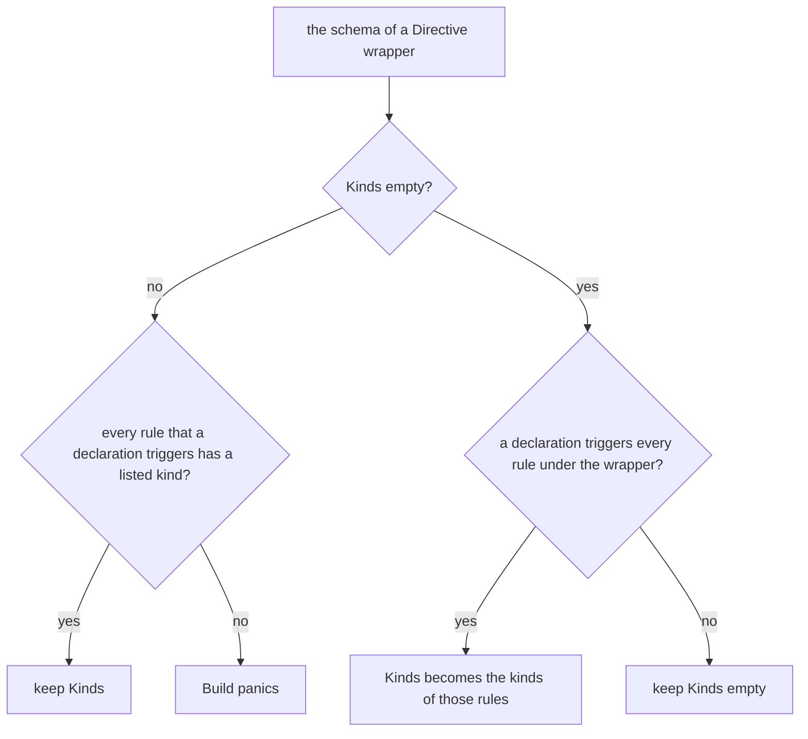

<!--
  ~ Copyright Dokimasia B.V. 2026
  ~ SPDX-License-Identifier: Apache-2.0
-->

# RFC-0027: The subject kinds of a directive

## Summary

A directive schema states the kinds of the declarations that an instance of
the directive may be written on. `directive.Schema` gets the field `Kinds`.
Validation reports an instance on a declaration of another kind as an Error
under a new kernel code, `MisplacedDirective`, and drops the instance.

When a schema leaves `Kinds` empty and a declaration of the source triggers
every rule under the directive, `Builder.Build` sets the field to the kinds of
those rules. Most plugins never fill the field themselves, and a declarative
plugin gets its kinds without a change of its manifest. A directive with a
rule on emitted values keeps an empty field, which admits every kind, until
its plugin states the kinds.

## Motivation

### The run ignores a misplaced directive

We reproduced the defect with the reference ensemble. A tree with
`+reference:builder` on an interface, `+reference:enum` on a struct and
`+reference:mock` on a function runs to exit 0. The run does not report a
finding, and it does not write a file.

Validation types each instance against its schema and checks the constraints
between the directives of one subject. No check relates an instance to the
kind of its subject. Dispatch then matches each instance to the rules under
its directive, and each rule has one kind. An instance on a declaration of
another kind matches no rule, so the author learns of the mistake only from
the missing output.

Java makes it a compile-time error to write an annotation where its `@Target`
meta-annotation does not admit it, and admits every declaration context where
an annotation interface has no `@Target`. C# reads `AttributeUsage`, whose
`ValidOn` lists the program elements that an attribute can be placed on. Rust
refuses `derive` on an item that is not a struct, a union or an enum, under
error E0774. Each language states the targets on the declaration of the
annotation, and its compiler refuses a misplaced annotation.

`meta.KeySpec.Kinds` lists the declaration kinds that a metadata key may be
stamped on. An empty list admits every kind, and the fact store refuses a
stamp on another kind. The directive schema has no counterpart.

### The kinds that Build can derive

`OnStruct`, `OnInterface` and the other rules over the declarations of the
source match declarations of their own kind alone. Where every rule under a
directive is such a rule, Build knows every kind on which an instance can
match a rule. An instance on any other kind cannot do anything.

`OnEmit` differs. Its rule runs on an emitted value, under the instance on
the origin of the value. The origin can be a declaration of any kind, and
Build does not know which kinds the plan emits values from. Only the plugin
of the rule knows on which kinds its authors write the directive. auditweaver
is such a plugin. Its directive `audit` puts a struct or an interface under
the weaver, and its rule runs on the methods that the plan emits from them.

## Detailed design

### Components

| Component | Where | Change |
|---|---|---|
| The schema field | `core/directive`, `Schema` | `Kinds []symbol.Kind` |
| Registration | `core/directive`, `Registry.Register` | refuses a kind that is not valid and a kind listed twice |
| Derivation | `core`, `Builder.Build` | fills `Kinds` of a schema from the rules under its directive |
| Validation | `core/directive`, `Validate` | reports `MisplacedDirective` |
| The code | `core/directive`, codes | `MisplacedDirective`, under the next free kernel number |
| The directive `audit` | `eidos-reference/auditweaver` | states `Kinds` |

The declarative host, the kernel's own schemas and the grammar do not change.

### Invariants

1. An instance that passes validation is on a declaration of a kind that its
   schema admits.
2. Where a declaration of the source triggers every rule under a directive,
   every instance that passes validation can match one of those rules.
3. `Kinds` lists the kind of every rule under its directive that a
   declaration of the source triggers.
4. An empty `Kinds` admits every kind.
5. A misplaced instance produces one finding. Validation checks no param of
   it.

### The schema field

```go
type Schema struct {
    // The fields that the grammar's schema already has.

    // Kinds lists the kinds of the declarations that an instance may
    // be written on. Empty admits every kind. Builder.Build fills an
    // empty field of a plugin's schema where it can derive the kinds,
    // and Validate refuses an instance on a declaration of another kind
    // under MisplacedDirective.
    Kinds []symbol.Kind
}
```

`Registry.Register` refuses a kind that `symbol.Kind` does not define and a
kind that the list repeats, as it refuses the other malformed fields of a
schema. The order of the list has no meaning. A finding lists the kinds in
the order of `symbol.Kind`.

### Derivation at Build

`Builder.Build` lowers the rules of a plugin and collects the schema of each
`Directive` wrapper. It sets the kinds of each schema before it hands the
schema on to registration:



A rule that a declaration triggers is a rule of the annotate or the generate
phase, whose invocation has one declaration of the source as its subject. A
rule of the emit phase is not one. Build lists the derived kinds in the order of `symbol.Kind`, so the
order of the rules does not change the schema.

Build panics on an explicit list that leaves out the kind of such a rule, as
it panics on the other faults of a declaration. The rule could never run. A
`Gated` wrapper puts rules under a kernel directive, whose schema the plugin
does not own, so Build derives nothing for it.

The declarative host lowers each rule of a manifest to `OnFunction`,
`OnInterface` or `OnStruct` inside the wrapper of its directive. So Build
derives the kinds of every directive of a manifest, and the manifest does
not need a key.

The reference ensemble declares ten directives, and Build derives the kinds
of nine. The rule under `audit` is a rule of the emit phase, so auditweaver
states `Kinds: []symbol.Kind{symbol.KindStruct, symbol.KindInterface}`.

### Validation

`Validate` checks the kind of the subject right after the name of an instance
resolves to a schema:

- An instance on a declaration whose kind `Kinds` admits continues to the
  checks that validation runs today.
- Validation drops any other instance and reports `MisplacedDirective` as an
  Error at the instance. The message contains the name of the directive, the
  kind of the subject and the kinds that the schema admits, such as "mock
  applies to an interface, and Run is a function".

Dispatch does not see a dropped instance, so the instance does not run a
rule. It does not take part in a requirement or a conflict, and it does not
count toward the limit of a single-instance directive. A misplaced negated
instance reports the same code. The kind is the `Kind` of the subject
identity that `Validate` receives, so the check does not read a declaration.

### Failure handling

| Failure | Where | Result |
|---|---|---|
| An instance on a declaration of a kind that its schema does not admit | `Validate` | `MisplacedDirective`, an Error at the instance. The instance runs no rule, and the plan fails, as it does for every validation Error |
| A schema that lists a kind that is not valid, or a kind twice | `Registry.Register` | Registration returns an error, and the composition does not build |
| An explicit `Kinds` that leaves out the kind of a rule that a declaration triggers | `Builder.Build` | Build panics, and the message contains the plugin, the directive and the kind |

### Cost

The field adds one slice to each schema, and the check searches it once per
instance. The search allocates nothing for an admitted instance, and a
finding allocates its message. Build allocates one slice for each schema
whose kinds it derives.

### Tests

- `directive`: `Register` refuses a kind that is not valid and a repeated
  kind. `Validate` admits an instance on a listed kind, and admits every kind
  for an empty field. It reports `MisplacedDirective` for an unlisted kind and
  drops the instance. A misplaced instance with a param error reports one
  finding.
- `core`: Build derives the kinds of a directive over rules that declarations
  trigger. It keeps the field empty for a directive with a rule of the emit
  phase, and keeps an explicit field. It panics on an explicit field that
  leaves out the kind of a rule under the directive.
- `eidos-declarative`: an instance of a directive of a manifest on a
  declaration of a kind that no rule of the directive handles reports
  `MisplacedDirective`.
- `eidos-reference`: a tree with a misplaced `builder`, `enum` and `mock`
  reports three Errors and writes nothing for them.

## Alternatives considered

### Derivation alone

Build could derive the kinds, and the schema could have no field. Validation
would then never check a directive with a rule of the emit phase, because
only its plugin knows the kinds of its origins. The field costs such a plugin
one line.

### An explicit field alone

Every plugin could state its kinds, as Java and C# require of an annotation.
Each existing plugin would then need an edit to get the check, and a plugin
without the field would keep the silent miss. A declarative manifest would
need a key that repeats what its rules state. With derivation, every plugin
whose rules declarations trigger gets the check without an edit. Invariant 3
keeps the explicit field consistent with the rules.

### A Warning in place of an Error

A misplaced instance never generates. With a Warning, the run would exit 0
with nothing generated, which is the defect that this design removes. Every
other finding of directive validation is an Error.

### A check after dispatch

The run could report each instance that did not match a rule. Under a rule of
the emit phase, an instance in a correct tree may not match a rule, such as
`audit` on a struct from which the plan does not emit a method. A warm run
would also have to record which instances matched in earlier runs. The kind
check runs before dispatch and reads one identity.

### A check of the doctor command alone

`doctor` checks the directives of each workspace. With the check in `doctor`
alone, `run` would still generate from a tree with a misplaced directive.

## Drawbacks

- A plugin whose directive has a rule of the emit phase has to state its
  kinds to get the check.
- A tree that contains a misplaced directive fails its next run. The directive
  never generated anything, so the Error points its author at a statement that
  never worked.

## Open questions

None.

## Unresolved and future work

None.

## References

- [RFC-0004: Metadata keys and the fact store](0004-metadata-facts.md)
- [RFC-0005: The directive grammar, schemas and validation](0005-directive-grammar.md)
- [RFC-0006: The authoring surface and dispatch](0006-authoring-surface-and-dispatch.md)
- [RFC-0025: Declarative plugins and their manifest](0025-declarative-plugins.md)
- [RFC-0026: The reference ensemble and the canary ring](0026-the-reference-ensemble-and-the-canary-ring.md)
- [Java SE 21, `java.lang.annotation.Target`](https://docs.oracle.com/en/java/javase/21/docs/api/java.base/java/lang/annotation/Target.html)
- [The Java Language Specification, Java SE 21, section 9.7.4](https://docs.oracle.com/javase/specs/jls/se21/html/jls-9.html#jls-9.7.4)
- [.NET, `AttributeUsageAttribute`](https://learn.microsoft.com/en-us/dotnet/api/system.attributeusageattribute)
- [Rust, error E0774](https://doc.rust-lang.org/error_codes/E0774.html)
