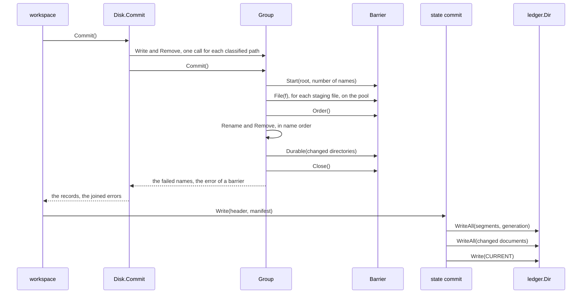

<!--
  ~ Copyright Dokimasia B.V. 2026
  ~ SPDX-License-Identifier: Apache-2.0
-->

# RFC-0028: Group commit of outputs and the record

## Summary

The disk sink commits one file at a time. For each path, in path order, it
writes a staging file, syncs it and renames it over the target. The syncs take
most of a cold run on disk. The sink does not sync a directory, so a crash of
the machine can undo a rename or a removal that the record already lists.

We propose to commit the files of a sink as one group. A pool of workers
writes every staging file, and the group passes one order barrier. One
goroutine then renames and removes in path order, and the group passes one
durability barrier. Each system gets the barrier that it documents for many
files at once:

- Linux 5.8 or newer, on ext4, XFS and btrfs: one syncfs(2) at each barrier,
  for a group of 32 names or more.
- macOS: fsync(2) of each staging file and one F_FULLFSYNC, then fsync(2) of
  each changed directory and one F_FULLFSYNC.
- Windows: a flush without a cache flush for each staging file and each
  changed directory, and one full flush at each barrier.
- Every other group: fsync(2) of each staging file and of each changed
  directory.

The disk ledger writes the blobs of the record in groups through the same
barriers. On btrfs, the commit of 3,000 files in 1,000 directories falls from
18.8 s to 0.09 s. On XFS, 30,000 files commit in 0.67 to 0.98 s instead of
12.3 s.

## Motivation

### The syncs take most of a cold run on disk

At 200,000 declarations, the reference binary writes 30,000 files. Its cold
run took 16.40 s on XFS and 3.94 s on tmpfs, where a sync does nothing. At
20,000 declarations, it writes 3,000 files, and its cold run on btrfs took
19.69 s.

`output.Disk.Commit` replaces each path in path order on one goroutine, and
`stagefile.Replace` syncs each staging file before its rename. We measured
that loop with a probe that commits files of 3 KiB into 1,000 directories:

| Files | btrfs | XFS |
|---|---|---|
| 3,000 | 18.8 to 19.1 s | 1.24 to 1.29 s |
| 30,000 | not measured | 12.3 to 12.4 s |

On btrfs, the loop took 18.8 to 19.1 s for the 3,000 files of a run that took
19.69 s. On XFS, it took 12.3 to 12.4 s for 30,000 files, and the cold run on
XFS took 12.46 s longer than the cold run on tmpfs.

### A crash can undo a commit that the record lists

The sink syncs each staging file and no directory, and a sync of a file does
not make its directory entry durable. The ledger writes the record durably
after the commits. After a crash of the machine, the record can list a rename
or a removal that the disk no longer contains. The next run repairs one of the
three cases:

- A created file whose rename the crash undid is missing. The next gate does
  not find it, and the run writes it again.
- An updated file whose rename the crash undid contains its old bytes, with
  the size, the times and the inode that the load before the commit recorded.
  The next gate proves the file unchanged from that stat and does not read it,
  so the warm run keeps the old bytes under a record that lists the new
  digest. A cold run writes the new bytes.
- A removed file that the crash restored is not in the record, so no gate
  reads it and no sweep removes it. The output of a declaration that no longer
  exists remains in the tree, and the build of the consumer compiles it.

### The record costs one sync for each blob

`ledger.Dir.Write` syncs the staging file and its directory for each blob. A
cold run writes up to 256 manifest documents, two segments, a generation and
`CURRENT` that way. For 256 documents in one directory with 16 writers, the
probe measured 0.37 to 0.42 s on btrfs and 0.05 to 0.26 s on XFS. On macOS,
`os.File.Sync` issues F_FULLFSYNC, so the record flushes the whole cache of
the drive twice for each blob: once for the file and once for its directory.

### The data is stable before the rename

A rename can be on stable storage before the data of its file. A crash then
leaves a file of zero bytes or of torn bytes under the name of the target. The
next run reads such a file as foreign or drifted, refuses to overwrite it and
reports an Error, so a person has to remove the file. renameio syncs a file
before its rename for the same reason. Every design in this document keeps
that order.

### The group belongs to the sink and the ledger

The sink and the ledger write the bytes, so the group belongs to them. The
workspace already commits the sink of each plan and of the sweep before it
writes the record, and it does not change. The commit of each sink is
independent. A failed plan keeps the previous generation of its files.

## Detailed design

### Components

| Component | Where | Change |
|---|---|---|
| The group | `core/internal/stagefile`, `Group` | stages the writes and removals of one commit, and applies them through a barrier |
| The barriers | `core/internal/stagefile`, `Barrier` and `System`, one file for each system | the calls that make the writes and removals of a group durable on each system |
| The disk sink | `core/output`, `Disk.Commit` | classifies each path on a pool and commits through one group |
| The group write of a ledger | `core/ledger`, `GroupWriter` | an optional interface that writes many blobs in one call |
| The disk ledger | `core/ledger`, `Dir.WriteAll` | writes many blobs through one group |
| The state commit | `core/internal/state` | writes the segments and the generation through one `WriteAll` and the changed manifest documents through another, then `CURRENT` through `Write` |

The `Sink` and `Ledger` interfaces, the order of the commits in the workspace
and in the state commit, and the gate do not change.

### Invariants

1. A reader of a target sees its old bytes or its new bytes, never a part of
   either.
2. After a crash of the machine at any point of a commit, each target contains
   its old bytes or its new bytes, never a part of either.
3. When `Commit` returns without an error for a path, the new bytes or the
   removal of that path are on stable storage.
4. The renames and removals of one commit run in path order, after the order
   barrier.
5. The workspace writes the record after every commit of the run has
   returned, so a crash of the machine does not undo a commit that the record
   lists.

### The group

```go
// Group is a set of writes and removals that one commit stages under a
// root. Commit applies them through a Barrier. A Group serves one commit,
// and one goroutine calls its methods.
type Group struct {
    // unexported fields
}

// Staging is the rule that sets the name of the staging file of a write.
type Staging uint8

const (
    // Reserved stages a write of name in name followed by Suffix. The
    // caller reserves the suffix, as the disk sink does.
    Reserved Staging = 1
    // Unique stages a write of name in name, a dot, 16 random hex digits
    // and Suffix, created exclusively. Groups that write one name at once
    // never share a staging file.
    Unique Staging = 2
)

// NewGroup returns an empty group over r. The group sets the names of its
// staging files by s, and makes its writes and removals durable through b.
func NewGroup(r *os.Root, s Staging, b Barrier) *Group

// Write stages body for name with perm. The directory of name does not
// have to exist. Write keeps body and does not copy it.
func (g *Group) Write(name string, body []byte, perm fs.FileMode)

// Remove stages the removal of name.
func (g *Group) Remove(name string)

// Commit applies the staged writes and removals. It returns the error of
// each name that failed, and the error of a barrier that failed. When the
// order barrier fails, Commit renames nothing, and every target keeps its
// old bytes. Commit calls b only for a group that has a write or a removal.
func (g *Group) Commit() (failed map[string]error, err error)
```

`Commit` runs five steps:

1. The group calls `Barrier.Start` with the number of its writes and
   removals.
2. A pool of 32 workers takes the writes. Each worker creates the missing
   directories above its target one level at a time, writes the staging
   file, calls `Barrier.File` on it and closes it. A write that fails removes
   its staging file.
3. The group calls `Barrier.Order` once.
4. One goroutine renames each staging file over its target and applies each
   removal, in name order.
5. The group calls `Barrier.Durable` once. It passes the directories that
   step 4 changed, and the parent of each directory that step 2 created.

A commit that calls `Start` also calls `Barrier.Close` once at its end. A
failed step does not skip it. A failure in step 2 or step 4 fails one name,
and the other names continue. The group does not read a context, so a commit
runs to its end once it begins. The commit of today behaves the same way in
both respects.



### The barriers

```go
// Barrier is the interface of the calls that make the writes and removals
// of one group durable on one system. A Barrier serves one group.
type Barrier interface {
    // Start runs once, before the first write. n is the number of writes
    // and removals of the group.
    Start(r *os.Root, n int) error
    // File runs on the worker that wrote f, before f closes.
    File(f *os.File) error
    // Order runs once, after every write and before any rename. When it
    // returns, the data of every staging file is on stable storage.
    Order() error
    // Durable runs once, after every rename and removal. When it returns,
    // the entries of dirs are on stable storage.
    Durable(dirs []string) error
    // Close releases what Start opened.
    Close() error
}

// System returns a new barrier of the running system.
func System() Barrier
```

| Case | `Start` | `File` | `Order` | `Durable` |
|---|---|---|---|---|
| Linux 5.8 or newer, on ext4, XFS or btrfs, 32 names or more | opens the root | nothing | syncfs(2) on the root | syncfs(2) on the root |
| macOS | opens the root | fsync(2) | F_FULLFSYNC on the root | fsync(2) of each directory, then F_FULLFSYNC on the root |
| Windows | opens the root for writing | NtFlushBuffersFileEx with FLUSH_FLAGS_NO_SYNC | NtFlushBuffersFileEx with flags 0 on the root | FLUSH_FLAGS_NO_SYNC on each directory, then flags 0 on the root |
| Linux in every other case, and every other system | nothing | fsync(2) | nothing | fsync(2) of each directory |

**Linux.** syncfs(2) gives "the same guarantees as fsync() called on every file
in the ... filesystem". A directory is a file in that sense. Since Linux 5.8,
syncfs(2) also reports a failed write-back. It reports each failure since the
descriptor that it receives was opened, so `Start` opens the root before the
first write. `System` reads the release from uname(2), and `Start` reads the
type of the root's filesystem from statfs(2).

syncfs(2) runs the sync operation of the filesystem. Linux 6.12 forwards that
operation to a FUSE server only for virtiofs. fsync(2) sends FUSE_FSYNC to
every FUSE server. The barrier calls syncfs(2) only on ext4, XFS and btrfs.
On another filesystem, it uses the last row.

The first syncfs(2) of a group of 8 files took 158 to 170 ms instead of 7 ms
while 1 GiB of another file was dirty on btrfs. syncfs(2) writes back the
dirty data of every process on the filesystem. The last row does not wait for
that data. A group of fewer than 32 names fits one round of the pool, so the
last row costs it about one fsync(2) latency. The barrier uses the last row
for such a group.

**macOS.** fsync(2) moves the data from the host to the drive. The drive can
still lose the data or reorder it. F_FULLFSYNC drains the queue of the device,
so "data that had been fsync'd on the same device before is guaranteed to be
persisted when this call returns". The order barrier issues one F_FULLFSYNC on
the root after an fsync(2) of each staging file. The durability barrier issues
one F_FULLFSYNC on the root after an fsync(2) of each changed directory. etcd
issues F_FULLFSYNC on the directory of its write-ahead log as well. The
barrier calls fsync(2) through `unix.Fsync`, because `os.File.Sync`
issues F_FULLFSYNC on macOS. A filesystem that refuses F_FULLFSYNC with
ENOTSUP gets fsync(2), as `os.File.Sync` does.

**Windows.** With FLUSH_FLAGS_NO_SYNC, NtFlushBuffersFileEx writes the data and
the metadata of a file to the device. It does not flush the cache of the
device. With flags 0 it also synchronizes the storage to flush that cache, and
the data that the earlier flushes wrote is on stable storage when it returns.
Git commits a batch of loose objects the same way, with
FLUSH_FLAGS_FILE_DATA_ONLY for each file and one full flush of a temporary
file. We use FLUSH_FLAGS_NO_SYNC because the size of a staging file is
metadata, and a reader after a crash needs the size.

The documentation lists NTFS, FAT and exFAT for FLUSH_FLAGS_NO_SYNC, and adds
ReFS for flags 0. `Start` reads the name of the root's file system with
GetVolumeInformationByHandleW. On another file system, such as ReFS, each file
and each directory gets flags 0. The documentation refuses a directory handle
only for FLUSH_FLAGS_FILE_DATA_SYNC_ONLY.

A flush needs a handle with write or append access, and a directory handle
that `os.Root` opens has read access alone. `Start` and `Durable` open the
root and each directory with CreateFile, GENERIC_WRITE and
FILE_FLAG_BACKUP_SEMANTICS for that reason. They open each one by its path
below the final path of the root. GetFinalPathNameByHandleW returns that final
path. NtFlushBuffersFileEx is not part of golang.org/x/sys/windows, so the
barrier loads it from ntdll.dll.

**A second device.** A staging file or a directory on another device than the
root gets a sync of its own. That sync is fsync(2) on Linux and the other
systems, F_FULLFSYNC on macOS, and NtFlushBuffersFileEx with flags 0 on
Windows. `File` compares the device of each staging file with the device of
the root, and `Durable` stats each directory. On Windows, the device is the
serial number of the volume.

**Other systems.** Every Unix system provides fsync(2), so the last row runs on
each of them. It costs one sync for each file and each directory.

### The pool

Without a sync, the writes of 30,000 staging files on the 32 workers of the
group took 0.22 to 0.24 s on btrfs. The last row of the barriers gains more
from concurrency on btrfs: 30,000 files took 21.8 s with 16 workers, 10.5 to
13.7 s with 32, 5.3 s with 64, 3.6 s with 128 and 2.0 s with 256. XFS took 4.2
to 4.9 s with 16 to 64 workers. The last row serves a large group only on a
configuration that we did not measure, such as NFS or Linux before 5.8, so the
pool keeps the size of the measured rows.

### The disk sink

`Disk.Commit` keeps every rule of its contract:

- It writes only the files whose bytes changed.
- It refuses to overwrite a drifted or a foreign file, unless `Overwrite`
  allowed the verdict of that file.
- It removes only the intact outputs of its brand.
- It returns its records in path order, and one joined error for the paths
  that failed.

It runs in three steps:

1. A pool of 32 workers reads each staged path and classifies it with one
   verdict function, which `Prepare` uses as well. The commit reads each path
   again, because a file can change after `Prepare`.
2. The sink stages each write and each removal into one group with `Reserved`
   names, and commits the group through the barrier that `System` returns.
3. The sink builds the records in path order from the verdicts and from the
   names that the group failed.

### The ledger

```go
// GroupWriter is the interface of a Ledger that writes many blobs in one
// call.
type GroupWriter interface {
    // WriteAll replaces the blob of each name in blobs the way Write does.
    // It returns once every blob is durable. It joins the error of each blob
    // that failed, and the other blobs still write. It returns the error of
    // ctx before it begins, and runs to its end once it begins.
    WriteAll(ctx context.Context, blobs map[string][]byte) error
}
```

`Dir` implements `WriteAll` through one group with `Unique` names, so two runs
that commit one blob at once do not share a staging file. `Mem` implements it
as one `Write` for each blob.

The state commit keeps its order, and each step is durable before the next one
begins:

1. It writes the region segment, the run segment and the generation through
   one `WriteAll`. A failure returns the error, and the parent remains the
   live generation.
2. It writes the changed manifest documents through a second `WriteAll`, and
   joins a failure into the returned error. It removes a document whose
   bucket is now empty through `Remove`, as it does today.
3. It writes `CURRENT` through `Write`.

`WriteManifest` writes the changed documents through one `WriteAll` as well.
Each caller uses `Write` for each blob where the ledger does not implement
`GroupWriter`.

### Failure handling

| Failure | Step | Result |
|---|---|---|
| `Start` fails | 1 | The group writes nothing. `Commit` returns the error, and every target is as it was |
| A staging file does not write, or `File` fails | 2 | The name fails, its staging file is removed, and the other names continue |
| `Order` fails | 3 | The group removes every staging file and renames nothing. `Commit` returns the error, and every target is as it was |
| A rename or a removal fails | 4 | The name fails, its staging file is removed, and the other names continue |
| `Durable` fails | 5 | The renames are visible. `Commit` returns the records and the error, so the plan fails, as a plan whose commit fails part-way fails today. The record keeps the previous entries of the plan. The next run renders the changed files again, finds their bytes on disk and writes the record |
| The process stops before step 4 | | Every target is as it was. A staging file with a `Reserved` name remains until a commit of the same path truncates it. One with a `Unique` name remains until the owner of its directory removes it, as a staging file of `ReplaceShared` does today |
| The machine stops during step 4 | | Each target is old or new, by invariant 2. The record is the previous one, and the next run writes again what differs |
| The machine stops after step 5 and before the record | | Every target is new. The next run renders the changed files again, finds their bytes on disk and writes the record |

### Cost

The probe ran on one workstation with Linux 7.2.7, on btrfs and on XFS. The
per-file barrier syncs each staging file, then each changed directory, on 32
workers. The syncfs(2) barrier calls syncfs(2) before and after the renames.
Each cell gives the range of four runs, two over a new tree and two over the
tree that the run before wrote. The column of today's commit gives the range
of two runs.

| Files | Filesystem | Today | Per-file barrier | syncfs(2) barrier | No sync |
|---|---|---|---|---|---|
| 3,000 | btrfs | 18.8 to 19.1 s | 1.27 to 1.56 s | 0.08 to 0.09 s | 0.06 to 0.08 s |
| 3,000 | XFS | 1.24 to 1.29 s | 0.49 to 0.54 s | 0.08 to 0.29 s | 0.04 to 0.07 s |
| 30,000 | btrfs | not measured | 10.5 to 13.7 s | 0.64 to 0.85 s | 0.51 to 0.78 s |
| 30,000 | XFS | 12.3 to 12.4 s | 4.6 to 4.9 s | 0.67 to 0.98 s | 0.36 to 0.38 s |

The syncs of the 1,000 directories took 0.31 to 0.41 s of the per-file barrier
on btrfs, and 3 to 63 ms on XFS. For the 256 manifest documents, a group with
the syncfs(2) barrier took 17 to 22 ms on btrfs and 7 to 11 ms on XFS, against
0.37 to 0.42 s and 0.05 to 0.26 s for the writes of today.

In the following table, each cell gives the range of a run of a group in one
directory over a new tree and a run over the tree that it wrote.

| Files | btrfs, per-file | btrfs, syncfs(2) | XFS, per-file | XFS, syncfs(2) |
|---|---|---|---|---|
| 1 | 13 to 19 ms | 11 to 14 ms | 1 ms | 1 ms |
| 8 | 19 to 20 ms | 13 to 14 ms | 2 ms | 1 ms |
| 32 | 19 to 20 ms | 14 ms | 5 ms | 2 to 3 ms |
| 128 | 58 to 67 ms | 16 to 18 ms | 18 to 19 ms | 4 to 7 ms |

With 1 GiB of random bytes of another file dirty in the page cache of btrfs, a
group of 8 files took 20 to 21 ms with the per-file barrier and 165 to 178 ms
with syncfs(2), in four runs of each. On XFS, the system reported at most
248 kB of dirty memory before the probe, so that test did not measure a
backlog there.

We did not measure the barriers of macOS and Windows, or syncfs(2) on ext4.
The group does not copy a body. It keeps one entry of 48 bytes for each name
on a 64-bit system: the name, the body and the mode. 30,000 names take
1.4 MB.

### Tests

- A recording barrier proves the order of the calls: `Start` once with the
  number of names, `File` for each write, `Order` once, the renames and
  removals in name order, `Durable` once with the changed directories and the
  parents of the created ones, and `Close` once.
- A barrier that fails one call at a time proves each row of the failure
  table.
- A table of the kernel release, the type of the filesystem and the number of
  names proves the choice of the Linux barrier.
- A ledger whose `WriteAll` fails one blob at a time proves that a failed
  segment or generation leaves the parent live, and that a failed document
  still lets the state commit write `CURRENT`.
- The existing cases of the disk sink pass unchanged: the writes of changed
  files, the refusals, the removals, and the records in path order.
- `System` runs for real in the gate on Linux, macOS and Windows. A test cannot
  crash the machine, so these runs prove that each primitive succeeds on its
  filesystem, and not the durability.
- An interleaved comparison of the binary at the last commit and with the
  change, on btrfs and XFS at 20,000 and 200,000 declarations, decides whether
  the change is kept.

## Alternatives considered

### Keep the serial commit

The commit of today syncs and renames one file after another. It is the
smallest code, and a reader can check its order of operations in one loop.

**Why not:** It took 18.8 s for 3,000 files on btrfs and 12.3 s for 30,000
files on XFS. It does not make a rename or a removal durable.

### Sync each file on a pool, on every system

The per-file barrier uses fsync(2) alone on every system, and its cost falls
with more workers on btrfs.

**Why not:** It took 10.5 to 13.7 s for 30,000 files on btrfs with 32 workers,
2.0 s with 256 workers, and 4.2 to 4.9 s on XFS. The syncfs(2) barrier
committed the same files in 0.64 to 0.98 s. The per-file barrier remains the
barrier of the groups and the systems without a cheaper primitive.

### syncfs(2) for every group on Linux

On a quiet filesystem, syncfs(2) was as fast as the per-file barrier or faster
at every size that we measured, so a group of fewer than 32 names could use it
as well.

**Why not:** With 1 GiB of another file dirty on btrfs, a group of 8 files took
165 to 178 ms with syncfs(2) and 20 to 21 ms with the per-file barrier. A
group of fewer than 32 names fits one round of the pool, so the per-file
barrier costs about one fsync(2) latency. A measurement in which the per-file
barrier of a larger group costs less than syncfs(2) under load would raise
the threshold.

### Sync nothing

Without a sync, the probe committed 30,000 files in 0.36 to 0.78 s. A run can
always derive its outputs again.

**Why not:** A crash of the machine can then leave a file of zero bytes under a
target. The next run refuses that file as foreign until a person removes it.

### One syncfs(2) after the renames

A group on Linux could skip the syncfs(2) before the renames and call
syncfs(2) only after them.

**Why not:** Without a syncfs(2) before the renames, a rename can be on stable
storage before the data of its file. A crash then leaves a file of zero bytes,
as in the previous alternative. The syncfs(2) before the renames took 135 to
413 ms at 30,000 files.

### F_BARRIERFSYNC at the order barrier on macOS

Apple documents a recipe for ordering two phases of operations: fsync(2) each
file after phase one, issue one F_BARRIERFSYNC, then run phase two. The
barrier does not wait for the drive, so it costs less than F_FULLFSYNC.

**Why not:** F_BARRIERFSYNC "requires hardware support, which Apple SSDs are
guaranteed to provide". On a drive without that support, HFS issues a full
flush in its place. The source of APFS is not public, so on another drive a
rename could be on stable storage before the data of its file. The order
barrier costs one F_FULLFSYNC for each group instead.

### A writeout of each file and one flush on Linux

Git's batch mode issues sync_file_range(2) for each file on Linux, then one
fsync(2) of a temporary file, and renames the objects after it.

**Why not:** Git documents that mode as as safe as fsync(2) on macOS and on
Windows only. On Linux, fsync(2) covers the data and the metadata of the file
that it syncs, and not those of the other files.

### Rename on the pool

The renames took 0.11 to 0.56 s at 30,000 files. Renaming on the pool would
shorten that step.

**Why not:** Renames in path order leave a prefix of the paths renamed when the
process stops, and a test can reproduce that state. A measurement of the
binary in which the renames take more than half of the commit would favour
the pool.

### One group for every plan

The plans and the sweep commit one after another, each through a group of its
own. One group across the plans and the sweep would pass two barriers in all.

**Why not:** A failed plan keeps the previous generation of its files, because
the commit of each plan is independent. A shared group would tie the plans
together. Every further group of 32 names or more adds two syncfs(2) calls. In
the probe, a syncfs(2) of a quiet filesystem took 4 to 8 ms on btrfs and at
most 1 ms on XFS. A measured run whose barriers take more than a tenth of its
commit would favour one group.

### One WriteAll for the whole record

The segments, the generation and the documents could share one group. That
group would pass two barriers fewer than the two calls.

**Why not:** A failed document still lets the state commit write `CURRENT`,
and a failed segment or generation does not. One call would need the error of
each blob. A second call adds one round of the pool. With the per-file
barrier, a group of 1 to 8 files took 13 to 20 ms on btrfs and 1 to 2 ms on
XFS.

### Coalesce concurrent calls of Ledger.Write

Concurrent calls of `Write` could share one barrier, and the `Ledger`
interface would not change.

**Why not:** The manifest writes its 256 documents on 16 writers. With one blob
for each concurrent writer in a group, those documents would pass 32 barriers
instead of two.

### A setting that turns the syncs off

A run on a disposable machine, such as a CI job, does not need durable
outputs.

**Why not:** The syncfs(2) barrier committed 30,000 files in under one second on
both filesystems. A setting adds a second behaviour that every test of the
sink has to cover.

## Drawbacks

- syncfs(2) writes back the dirty data of every process on the filesystem, so
  the barrier of a group of 32 names or more can wait for writes that eidos
  did not make. With 1 GiB of another file dirty on btrfs, the first
  syncfs(2) of a group took 158 to 170 ms instead of 7 ms.
- syncfs(2) reports a failed write-back of any file on the filesystem. A
  failed write-back of a file of another program fails the next barrier of a
  group, and the plan of that group fails.
- We did not measure the barriers of macOS and Windows, or syncfs(2) on ext4.
  Their calls follow the documentation of each system, the batch mode of Git
  and the directory sync of etcd.
- A root on another filesystem than ext4, XFS and btrfs, such as NFS or a FUSE
  mount, keeps the cost of the per-file barrier.
- On Windows, `Durable` opens each changed directory by its path, outside the
  jail of `os.Root`. The flush does not change any byte, so a link that leads
  the open out of the root costs one flush of another directory.
- eidos-core gains golang.org/x/sys v0.49.0, for syncfs(2), statfs(2),
  uname(2), the F_FULLFSYNC command of macOS, CreateFile,
  GetVolumeInformationByHandleW, GetFinalPathNameByHandleW and the loading of
  ntdll.dll.
- The code gains the group, four barrier files (Linux, macOS, Windows and the
  other systems) with their tests, the optional `GroupWriter` with two
  implementations, a new `Disk.Commit`, and the two group writes of the state
  commit.

## Open questions

None.

## Unresolved and future work

- A measurement of the barriers on macOS and on Windows, and of syncfs(2) on
  ext4, is not part of this proposal.

## References

| What | Where |
|---|---|
| fsync(2), Linux | https://man7.org/linux/man-pages/man2/fsync.2.html |
| syncfs(2), Linux | https://man7.org/linux/man-pages/man2/syncfs.2.html |
| statfs(2), Linux | https://man7.org/linux/man-pages/man2/statfs.2.html |
| Linux 6.12, the error check of syncfs(2) | https://github.com/torvalds/linux/blob/v6.12/fs/sync.c |
| Linux 6.12, the sync of a FUSE filesystem | https://github.com/torvalds/linux/blob/v6.12/fs/fuse/inode.c |
| Linux 6.12, the sync of virtiofs | https://github.com/torvalds/linux/blob/v6.12/fs/fuse/virtio_fs.c |
| fcntl(2), macOS, F_BARRIERFSYNC and F_FULLFSYNC | https://github.com/apple-oss-distributions/xnu/blob/f6217f891ac0bb64f3d375211650a4c1ff8ca1ea/bsd/man/man2/fcntl.2 |
| fsync(2), macOS | https://github.com/apple-oss-distributions/xnu/blob/f6217f891ac0bb64f3d375211650a4c1ff8ca1ea/bsd/man/man2/fsync.2 |
| HFS, the full flush in place of a barrier | https://github.com/apple-oss-distributions/hfs/blob/d1bac2f062e6e9c0dfcce302d9aacb10173d0eea/core/hfs_vfsutils.c |
| Go 1.27.2, the F_FULLFSYNC of os.File.Sync | https://github.com/golang/go/blob/go1.27.2/src/internal/poll/fd_fsync_darwin.go |
| etcd, F_FULLFSYNC on macOS | https://github.com/etcd-io/etcd/blob/f061acd0902d489041448cdd19d71a345d27b9f5/client/pkg/fileutil/sync_darwin.go |
| etcd, the sync of the directory of the log | https://github.com/etcd-io/etcd/blob/f061acd0902d489041448cdd19d71a345d27b9f5/server/storage/wal/wal.go |
| NtFlushBuffersFileEx and its flags | https://learn.microsoft.com/en-us/windows-hardware/drivers/ddi/ntifs/nf-ntifs-ntflushbuffersfileex |
| CreateFileW, opening a directory | https://learn.microsoft.com/en-us/windows/win32/api/fileapi/nf-fileapi-createfilew |
| GetVolumeInformationByHandleW | https://learn.microsoft.com/en-us/windows/win32/api/fileapi/nf-fileapi-getvolumeinformationbyhandlew |
| GetFinalPathNameByHandleW | https://learn.microsoft.com/en-us/windows/win32/api/fileapi/nf-fileapi-getfinalpathnamebyhandlew |
| Git, core.fsyncMethod | https://git-scm.com/docs/git-config#Documentation/git-config.txt-corefsyncMethod |
| Git, the writeout and the hardware flush of git_fsync | https://github.com/git/git/blob/6de20f6092dcf9bdb1c8efe03db4b70c82b423dd/wrapper.c |
| Git, the flush before the renames of a batch | https://github.com/git/git/blob/6de20f6092dcf9bdb1c8efe03db4b70c82b423dd/object-file.c |
| Git, the writeout on Windows | https://github.com/git/git/blob/6de20f6092dcf9bdb1c8efe03db4b70c82b423dd/compat/win32/flush.c |
| renameio, atomicity and durability | https://github.com/google/renameio |
| golang.org/x/sys v0.49.0 | https://pkg.go.dev/golang.org/x/sys@v0.49.0 |
| The output contract | [RFC-0010](0010-output-contract.md) |
| The end-to-end run and its commit | [RFC-0017](0017-the-end-to-end-run.md) |
| Warm runs and the sealed state | [RFC-0020](0020-warm-runs-and-the-sealed-state.md) |
