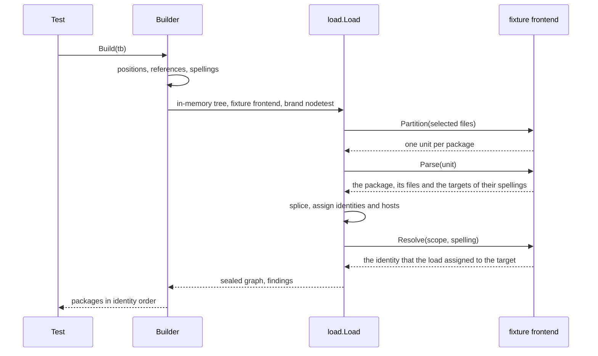

<!--
  ~ Copyright Dokimasia B.V. 2026
  ~ SPDX-License-Identifier: Apache-2.0
-->

# RFC-0032: The fixture builder

## Summary

A test of a plugin, a rules package or a kit runs over a declaration graph.
Each such test writes the graph as node literals, together with the
identities, the hosts and the link targets that the kernel's load would
assign. We propose a fixture builder in the kernel, the package `nodetest`,
which the SDK re-exports. A test writes its declarations as node literals
without identities, and `Build` loads them through the kernel's own load, so
every identity, host and target in the fixture is the one that the load
assigns. The testing package of each satellite provides a spelling adapter,
which writes the source spelling of a structural type reference in its
language. A parity test pins each spelling to the frontend of the language.

## Motivation

### Hand-written identities restate the load

The load assigns each declaration its identity: the package, the chain of
the enclosing types, the name, the kind, and a discriminator in a language
that overloads. It gives an unnamed parameter the name of its position. It
writes the host of each member and resolves each type spelling to its
target. A test that builds a graph by hand writes these rules again:

- The fixture of the Go annotator writes 30 identities and 8 targets.
- The fixture helpers of the shape catalog name the parameters p0 and p1,
  spell each owner as the host and the method joined by a dot, and add a
  struct for each host of a method.
- The test file of the declarative module writes 37 identity literals.

Outside the kernel, test files write 300 identity literals, as fixtures and
as expected values, and at least 86 type references with a target that the
test writes. A change to a rule of the load leaves these fixtures unchanged,
and their tests still pass, because each test checks a graph that no load
produces.

### The architecture documents promise a builder

In the testing document, the fixture builders have a neutral core with a
spelling adapter in each satellite. In the languages document, the testing
package of a satellite contains the fixture builder. No module contains
either. No kit has the entry points of a builder, its sub-builders or its
type-reference constructors.

### Why the kernel

The kernel's load writes the identities, the hosts and the targets. A test
without a parser of its language can run that load only through the
kernel. The SDK re-exports the kernel's kits to plugins and satellites, so
a plugin author gets the builder with the other kits. The source spelling
of a type is a fact of each language. Each satellite writes the spelling
adapter of its language, as it writes its toolchain adapter.

## Detailed design

### Components

| Component | Module | Responsibility |
|---|---|---|
| `nodetest.Builder` | eidos-core, re-exported as `sdk/nodetest` | collects the files of a fixture and builds them through the load |
| The fixture frontend, unexported | eidos-core | serves the files of a fixture to the load as units, and resolves the references that `Builder.Ref` made |
| `nodetest.Language` | eidos-core | the interface of a spelling adapter |
| `nodetest.Neutral` | eidos-core | the spelling adapter of a fixture in a language without a satellite |
| `testing.Language` | eidos-lang-go, eidos-lang-typescript, eidos-lang-java, eidos-lang-rust | the spelling adapter of each language |

### Invariants

1. Every identity, host and target of a built fixture is the one that the
   kernel's load assigns. The builder restates no rule of the load.
2. A spelling adapter writes the spelling that the frontend of its language
   records for the same type in canonical source. A parity test of each
   form pins it.
3. A fixture that the load changes fails its test. Any finding of the load
   fails `Build`.
4. The builder has no setter for a field of the model. A declaration is a
   node literal, so a change to the schema breaks the fixture at compile
   time.

### The API

```go
package nodetest

// Language is the part of a fixture that its language decides: the
// identity of the language, whether the language overloads, and how its
// source spells a reference. The testing package of a satellite provides
// one, and [Neutral] serves a language without a satellite.
type Language interface {
    // Lang returns the language of every declaration of the fixture.
    Lang() symbol.Lang

    // Overloads reports whether the language declares two callables of
    // one name in one scope, as plugin.Frontend.Overloads reports it.
    Overloads() bool

    // Spell returns the source spelling of a structural reference. Every
    // child of ref has its spelling when Spell runs, and Spell does not
    // change ref. Spell returns an error for a form that the language does
    // not spell.
    Spell(ref *node.TypeRef) (string, error)

    // Qualify returns the spelling of a reference to the declaration name
    // in package pkg, from a file of another package. name is the name of
    // the declaration after the names of its enclosing types, each
    // followed by a dot.
    Qualify(pkg *node.Package, name string) string
}

// Neutral is the spelling adapter of a language without a satellite, such
// as the fake language of a kit's own tests. It spells a structural
// reference in a notation of its own, such as list(int) and
// map(string, int), which no language parses. It qualifies a reference
// with the name of the package and a dot.
type Neutral struct {
    // Language is the language of the fixture.
    Language symbol.Lang
    // Overloading is what Overloads reports.
    Overloading bool
}

// Builder collects the packages and files of one fixture in one language,
// and builds them through the kernel's load. The zero Builder is not
// usable, so a test calls New. A Builder is not safe for concurrent use.
type Builder struct{ /* unexported */ }

// New returns an empty builder for a fixture in the language of l.
func New(l Language) *Builder

// Package returns the package at the slash-separated path, and creates it
// on the first call for the path. A created package has the last segment
// of the path as its name, and a test can change any field of it before
// Build.
func (b *Builder) Package(path string) *node.Package

// File returns the file at the workspace path in the package pkg, and
// creates both on the first call. It appends decls to the declarations of
// the file. A test can change any field of the file before Build. A path
// that two packages claim fails Build.
func (b *Builder) File(pkg, path string, decls ...symbol.Symbol) *node.File

// Ref returns a named reference to target, with args as its type
// arguments. Build spells it, and the load gives it the identity of
// target as its target. target is a type declaration or a variant of the
// fixture.
func (b *Builder) Ref(target node.Declaration, args ...*node.TypeRef) *node.TypeRef

// Build loads the fixture through the kernel's load and returns the
// packages of the load's graph in identity order. After Build, every
// package, file and declaration of the fixture has the identity that the
// load assigned to it, every member has its host, and every reference that
// Ref returned has its target. The returned packages are the load's
// copies, so a change to a declaration after Build changes nothing that
// Build returned. A second call returns the same packages.
//
// Build fails the test for each cause in the table of failures.
func (b *Builder) Build(tb assert.TB) []*node.Package

// Named returns a reference to a type that the fixture does not declare,
// such as a builtin, with args as its type arguments. The load leaves it
// without a target, unless it spells a type parameter in scope, which
// the load resolves as it resolves one in source.
func Named(spelling string, args ...*node.TypeRef) *node.TypeRef

// External returns a reference to a type of the package pkg outside the
// fixture, with args as its type arguments. pkg is what an import of the
// language names. The load leaves the reference without a target.
func External(pkg, spelling string, args ...*node.TypeRef) *node.TypeRef

// Optional, List, Array, Map, Stream, Borrow, Func, Tuple, Union,
// Intersection, Wildcard and Inline return a reference of their form,
// with the children in the order of the form. A nil child is an empty
// reference, so the form keeps its arity, except that Wildcard with a nil
// bound is unbounded and has no child. Build writes the spelling and the
// position of each.
func Optional(elem *node.TypeRef) *node.TypeRef
func List(elem *node.TypeRef) *node.TypeRef
func Array(length int, elem *node.TypeRef) *node.TypeRef
func Map(key, value *node.TypeRef) *node.TypeRef
func Stream(elem *node.TypeRef) *node.TypeRef
func Borrow(elem *node.TypeRef) *node.TypeRef
func Func(params, results []*node.TypeRef) *node.TypeRef
func Tuple(members ...*node.TypeRef) *node.TypeRef
func Union(members ...*node.TypeRef) *node.TypeRef
func Intersection(members ...*node.TypeRef) *node.TypeRef
func Wildcard(variance symbol.Variance, bound *node.TypeRef) *node.TypeRef
func Inline(fields []*node.Field, methods []*node.Method) *node.TypeRef
```

The constructors assemble their references through `plugin.Composite` and
`plugin.FuncType`, which the frontends use. A test that needs a spelling or
a position of its own sets it on the reference, and Build keeps it.

### Build



Build takes these steps once:

1. Checks. Build checks that the language has an identity, that no file
   path belongs to two packages, that no declaration or reference appears
   in two places, and that every reference from `Ref` targets a type
   declaration or a variant of the fixture.
2. Positions. Each file of the fixture is at line 1 of its path. Each
   declaration that `node.Walk` visits in the file is at the next line, at
   column 1, where the test left its position zero. A type reference has
   the position of the declaration that contains it, where the test left
   it zero.
3. References. Each reference from `Ref` gets the name of its target, after
   the names of the target's enclosing types, each followed by a dot. A
   reference from another package gets that name through
   `Language.Qualify`, and the path of the target's package as its
   `Package`. Each file records the target of each such spelling. One
   spelling with two targets in one file fails Build.
4. Spellings. Each structural reference with an empty spelling gets the
   spelling that `Language.Spell` returns, children before parents.
5. Load. Build runs `load.Load` under the context of tb, which
   `assert.Context` returns. The tree is in memory and has an empty file at
   the path of each fixture file. The load's one frontend is the fixture
   frontend. Its brand is `nodetest`.
6. Result. Build collects the packages of the sealed graph in identity
   order. It copies the identity of each onto the package that
   `Builder.Package` returned.

The load assigns the identities and the hosts into the files and the
declarations that the fixture frontend hands it. Its resolution writes the
targets into the references. These nodes are the test's own. After Build, a
test reads the identity of a declaration from the declaration.

### The fixture frontend

| Method | Returns |
|---|---|
| `Name` | `nodetest` |
| `Version` | `1` |
| `Lang`, `Overloads` | what the Language returns |
| `Syntax` | the line comment `//`, which no file contains |
| `Selection` | `**`, which claims every file of the in-memory tree |
| `Partition` | one unit per package, in the order of the first call of `Builder.Package` for each |
| `Parse` | copies the name, the documentation and the position of the package into the unit's package, appends the files of the package, and records the targets of the spellings of each file as its scope |
| `Resolve` | the identity that the load assigned to the target of the spelling in the file, and nil for every other spelling |

`Resolve` reads the identity from the target after the assignment. The
builder does not write any part of an identity. A reference from `Named` or
`External` keeps its spelling alone. A builtin and a type outside the
workspace keep their spellings alone in a load of source too.

### Spellings per language

| Form | Go | TypeScript | Java | Rust | Neutral |
|---|---|---|---|---|---|
| Optional | `*T` | `T\|undefined` | refused | refused | `optional(T)` |
| List | `[]T` | `T[]` | `T[]` | `[T]` | `list(T)` |
| Array | `[3]T` | refused | refused | `[T;3]` | `array[3](T)` |
| Map | `map[K]V` | `{[key:K]:V}` | refused | refused | `map(K, V)` |
| Func | `func(A, B) (R, error)` | `(p0:A,p1:B)=>R` | refused | `fn(A,B)->R` | `func(A, B)(R)` |
| Tuple | refused | `[A,B]` | refused | `(A,B)` | `tuple(A, B)` |
| Union | refused | `A\|B` | refused | refused | `union(A, B)` |
| Intersection | refused | `A&B` | refused | `dyn A+B` | `intersection(A, B)` |
| Stream | `chan T` | refused | refused | refused | `stream(T)` |
| Borrow | refused | refused | refused | `&T` | `borrow(T)` |
| Wildcard | refused | refused | `?`, `?extends T`, `?super T` | refused | `wildcard()`, `wildcard(out T)`, `wildcard(in T)` |
| Inline | `struct{ A int }`, `interface{ M() }` | `{a:string;m():void}` | refused | refused | `inline(a, m())` |
| A named child with arguments | `Map[K, V]` | `Map<K,V>` | `Map<K,V>` | `Map<K,V>` | `Map<K, V>` |
| Qualify | `store.Row` | `Row` | `acme.store.Row` | `acme::store::Row` | `store.Row` |
| Overloads | false | true | true | false | `Overloading` |

The language rules behind the table:

- The Go adapter writes its composite types through `golang.Restate`, the
  one writer of Go composite syntax, which the spoke and the backend use.
  The adapter writes an inline body on one line, with its members separated
  by semicolons. It spells an inline reference without members as
  `struct{}`, and refuses one with both fields and methods.
- The TypeScript adapter spells a function type with one result, because
  the syntax of a TypeScript function type requires its return type. It
  refuses a function type without a result. It puts a union, an
  intersection or a function type in parentheses where such a type is a
  child of another form.
- The Rust adapter refuses a tuple without members, because its frontend
  records the unit type as Named.
- The Java adapter refuses a wildcard that has a bound and no variance,
  which its frontend never records.

A spelling that a frontend reads in another form, such as Go's `<-chan T` or
Rust's `&mut T`, is a spelling that the test sets on the reference.

The test of each adapter loads canonical source through the frontend of
the language. It builds the same declarations through `nodetest` with the
adapter. It then compares the spelling, the form, the children, the split,
the length and the variance of each reference. It also compares `Overloads`
with the frontend's. The test of `nodetest` builds the declarations of a
tree in the kernel's scripted language. It compares their identities, hosts
and targets with what the scripted frontend's load of that tree assigns.

### Failures

| Cause | Build |
|---|---|
| The language returns an empty identity | fails the test |
| Two packages claim one file path | fails the test and names the path |
| One declaration or one reference appears in two places of the fixture | fails the test and names its kind |
| `Ref` targets a declaration that no file of the fixture contains | fails the test and names the target |
| `Ref` targets a kind other than a type declaration or a variant | fails the test and names the kind |
| One file spells two targets alike | fails the test and names the spelling and the file |
| The spelling adapter refuses a form | fails the test with the error of `Spell` |
| The load returns an error | fails the test with the error |
| The load reports a finding, such as a duplicate declaration | fails the test with every finding |
| The assignment panics on a structural defect, such as a declaration without a name | fails the test with the panic, which runs on the goroutine of Build |

### Example

The fixture of the Go annotator writes each identity and each target:

```go
stringer := &node.Interface{
    ID: id("", "Stringish", symbol.KindInterface), Name: "Stringish",
    Methods: []*node.Method{{
        ID: id("Stringish", "String", symbol.KindMethod), Name: "String", Abstract: true,
        Returns: []*node.Return{{Type: &node.TypeRef{Spelling: "string"}}},
    }},
}
wrapper := &node.Struct{
    ID: id("", "Wrapper", symbol.KindStruct), Name: "Wrapper",
    Embeds: []*node.Embed{{
        Ref: &node.TypeRef{Spelling: "Stringish", Target: stringer.ID},
    }},
}
```

With the builder, the test writes the declarations and their links:

```go
b := nodetest.New(gotesting.Language{})
stringer := &node.Interface{
    Name: "Stringish",
    Methods: []*node.Method{{
        Name: "String", Abstract: true,
        Returns: []*node.Return{{Type: nodetest.Named("string")}},
    }},
}
wrapper := &node.Struct{
    Name: "Wrapper",
    Embeds: []*node.Embed{{Ref: b.Ref(stringer)}},
}
b.File(fixPackage, "fix/a.go", stringer, wrapper)
pkgs := b.Build(t)
```

### Callers

These callers move onto the builder:

- The fixture helpers of the shape catalog. `Method` and `Function` return
  declarations without identities, and `Package` takes the test's TB and
  builds through `nodetest.Neutral`.
- The fixture of the Go annotator.
- The fixtures of the declarative module that write identities. Its
  benchmark corpus keeps its literals, because the count of declarations is
  its subject.
- The fixtures of the conformance module that write identities in the
  scripted language. A package without files keeps its literal, because no
  load produces one.

These callers keep their literals:

- The kernel's own fixtures. The kernel tests the store, the dispatch and
  the facts without the load, so a defect of the load fails only the
  load's own tests.
- A test whose input is one type reference, such as a test of a rule that
  folds a form. The literal is the input under test.
- A test that compares a frontend's output with the graph that it expects.

The modules move from commit 6f23571 of assert, which implements its
definition 7.1.0, to v0.1.1, which adds `assert.Context`. `rulestest.Loaded` runs its load under the context of its
TB too. The testing document and the languages document describe the
builder where they promise it.

## Alternatives considered

### A builder with a setter for each field

Each kind would have a sub-builder, such as a struct builder with `Field`,
`Method`, `Embed` and `Extends`, and a setter for each flag. A test would
write `b.Package("acme/store").Struct("Row").Field("ID", Named("int"))`.

**Why not:** the node model has 23 kinds, and a setter for each field of
each kind restates the schema by hand. A field that the schema adds has no
setter until someone writes one. A literal of the generated model can set
every field, and it fails to compile when the schema changes. The builder
takes over what a test would otherwise write by hand: the identities, the
hosts, the positions and the targets.

### Builders that the model generator writes

The model generator would write the sub-builders from the schema, as it
writes the kinds, the walk and the codec.

**Why not:** a generated setter stores a field the way a literal does, and
it adds a generated layer whose only consumers are tests. The identities and
the targets still need the load.

### Identities that the builder computes

The builder would derive each identity from the package, the owner chain
and the name, as the fixtures of the kernel do.

**Why not:** it restates the rules of the load: the discriminator of an
overloaded callable, the name of an unnamed parameter by its position, the
owner of a method that is declared outside its type, and the dropping of a
duplicate. A change to one of them leaves the builder's graph wrong while
its tests pass.

### The load's assignment and resolution as exported functions

The load would export its assignment and its resolution, and the builder
would call them on the fixture's packages.

**Why not:** the assignment depends on the splice of units, on the record of
duplicates and on the index that the resolution reads. Exporting them
changes the API of a finished package for a test kit. Running the whole load
through a frontend uses the load as every frontend uses it. It does not add
API to the load.

### Source fixtures alone

A test would write source text and load it through the frontend of its
language, as `rulestest.Loaded` does.

**Why not:** this remains the way to get a graph exactly as a frontend
produces it. The kernel's kits and a plugin that serves every language have
no frontend of their own, and a test of such a plugin would bind it to one
satellite.

### Constructors for each language

Each satellite would export constructors in its own syntax, such as a Go
`Pointer`, `Slice` and `Chan` and a TypeScript `Union` and `Record`.

**Why not:** each language would restate every form, and a test written for
one language would change its constructors to move to another. Neutral
constructors with a spelling adapter share one set of constructors, and a
test moves between languages through its `Language`.

### Directives and stamps on the builder

The builder would record raw directives and classification stamps on its
declarations, and the fixture frontend would attach them during the parse.

**Why not:** `plugintest.Fixture` attaches a directive with `Attach` and
`Validated` and stamps a fact with `Stamp`, each by identity. After Build,
the identities are on the test's declarations. A second mechanism on the
builder would duplicate the first.

## Drawbacks

- `nodetest` adds three types, `New`, four methods of `Builder`, 14
  constructors and four methods of `Neutral`: 26 exported identifiers beside
  the methods of the interface and the two fields of `Neutral`.
- Each of the four satellites adds a type with four methods, and a parity
  test that loads source through its frontend. The tests of the TypeScript,
  Java and Rust testing packages then build with cgo, as their frontends do.
- Each Build runs one load: a stat and a digest of each file, a parse that
  copies nodes, the splice, the assignment, the resolution, the encoding of
  one region per package, and a decode of every package.
- A test reads identities from its own declarations and loads the returned
  packages, which are copies. A check of pointer identity between a
  declaration of the test and one of the returned packages fails.
- A fixture in `Neutral` has spellings that no language parses. A test that
  renders such a fixture through a backend sets the spellings itself.
- Every module that requires assert changes its requirement.

## Open questions

None.

## Unresolved and future work

- Constructors of emit references that take the arguments of these
  constructors are not proposed here.
- A spelling adapter for protobuf is not proposed. A read-only language has
  no testing package, and a protobuf fixture is a source file that
  `rulestest.Loaded` loads.
- A `plugintest.Fixture` that loads a source tree is not proposed here.
- assert v0.2.0, which admits one allocation at a ceiling of 0, is not
  adopted here.

## References

| What | Where |
|---|---|
| The toolchain-adapter skeleton and the fixture builders | [13-testing-and-conformance.md](../architecture/13-testing-and-conformance.md) |
| The anatomy of a satellite | [11-languages.md](../architecture/11-languages.md) |
| D84, the children of a structural reference | [21-decisions.md](../architecture/21-decisions.md) |
| assert v0.1.1 | <https://github.com/dokimasia/assert-go/releases/tag/v0.1.1> |
