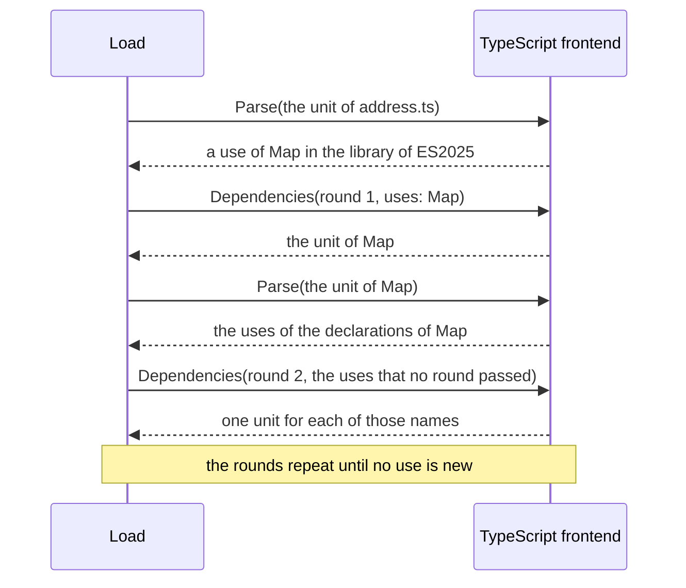

<!--
  ~ Copyright Dokimasia B.V. 2026
  ~ SPDX-License-Identifier: Apache-2.0
-->

# RFC-0084: The declarations of the TypeScript library that a load uses

## Summary

We propose that a load of TypeScript contains the declarations of the library that the references
of its units use, and no other declaration of the library. A unit records each name that one of
its references can resolve to outside the workspace as a use. A dependency round of the kernel
passes the uses of the loaded units to their frontend, as it passes their imports. The TypeScript
frontend places one unit for each used name of a library, with the statements of that name from
every file of the library. The rounds repeat while the loaded units have uses that an earlier round
did not pass.

## Motivation

The accepted design loads the library that a project selects as one dependency unit of all its
files. A fixture of a one-file tree with the default library contains 69,312 declarations, and
69,303 of them are declarations of the library.

- The specs of four generator plugins run in 15.6 to 20.8 s with the store of the library and in
  0.24 to 0.49 s without it. Each case of these specs loads a fixture through `plugintest.Loaded`.
- A load of a one-file tree takes 377 to 394 ms with the store and 0.10 to 0.17 ms without it. The
  load allocates 114.7 MB in 585,600 allocations.
- A CPU profile of 11 such loads has the parse and the lowering of the library at 69%, the link at
  9%, the loops of `plugintest.Loaded` over the declarations at 6% and the garbage collector at 6%.
- A cold run of the command line over a corpus of TypeScript fixtures takes 0.60 s with the
  default library and 0.19 s with the library of ES2024, which has no DOM. Its peak memory is
  224 MB with the default library and 89 MB with the library of ES2024. A warm run takes 0.13 s
  against 0.09 s.

A load of a one-file tree that references one type of the library needs the declarations of that
type and the declarations that their references can resolve to, followed through the references
of those declarations. For common types they are a small part of the default library of 69,303
declarations under 2,233 global names. The table lists what such a load contains under the design
of this RFC: the units of the library, their declarations, and the last round that places a unit.

| Type | Units | Declarations | Share of the library | Last round |
|---|---|---|---|---|
| `Error` | 3 | 35 | <0.1% | 3 |
| `Iterable` | 5 | 263 | 0.4% | 4 |
| `AbortSignal` | 10 | 245 | 0.4% | 3 |
| `Map` | 9 | 402 | 0.6% | 5 |
| `Set` | 10 | 431 | 0.6% | 5 |
| `Promise` | 13 | 557 | 0.8% | 6 |
| `Date` | 14 | 2,439 | 3.5% | 5 |
| `Uint8Array` | 21 | 3,005 | 4.3% | 5 |
| `Array` | 21 | 3,513 | 5.1% | 5 |
| `HTMLElement` | 1,215 | 43,231 | 62.4% | 15 |

`Date`, `Uint8Array` and `Array` load the namespace `Intl` whole, because a namespace is one global
name.

The link, the indexes of a fixture, the loops of `plugintest.Loaded` and the enumeration of the
annotate phase grow with the declarations of the graph, as the parse does. A memo or a load that
the fixtures share removes the parse from each fixture and leaves the other steps. A load without
the unused declarations removes every step for them, in a test binary and in a run of the command
line.

The load runs the dependency rounds and passes each round its needs. Only the frontend can tell
which names of the library a reference can mean. The round contract needs a need by name for that,
and the TypeScript frontend needs units of one name.

## Detailed design

### Components

| Component | Package | Change |
|---|---|---|
| Source unit | `eidos-core/plugin` | `SourceUnit.Use` records a use, and `SourceUnit.Uses` returns the uses |
| Dependency round | `eidos-core/plugin` | `DependencyRound.Uses` lists the uses that no earlier round passed |
| Region | `eidos-core/store` | `Region.Uses` keeps the uses of a parsed unit for the memo and the record |
| Load | `eidos-core/frontend/load` | the rounds pass the uses, and `UnitRecord.Uses` and `DoorRecord.Uses` record them |
| State | `eidos-core/internal/state` | the codecs of the region, the unit record and the door record |
| SDK | `eidos-sdk` | the regenerated facade |
| Library index | `eidos-lang-typescript/frontend/library` | a generated index of the statements of the global names of each file |
| Library store | `eidos-lang-typescript/frontend` | serves the statements of one name of one file at `<key>/<file>#<name>` |
| Dependency round of TypeScript | `eidos-lang-typescript/frontend` | places one unit for each use that the library of its package declares |
| Lowering | `eidos-lang-typescript/frontend` | records the uses of a source file and of a library unit |

### The use

A use is a bare identity, which has a language, a package and a name and no kind. Each unit records
a use for each name that one of its references can resolve to outside the workspace. The load
passes the uses of the units of a frontend to its dependency rounds, as it passes their imports.

```go
package plugin

// Use records that a reference of the unit can resolve to a declaration
// outside the workspace under the bare identity id, which has the
// language, the package and the name of the declaration and no kind. Use
// keeps those three parts of id. The load passes each use of a unit once
// to a dependency round of the frontend that parsed the unit, and the
// round places a unit that declares it.
func (u *SourceUnit) Use(id symbol.Identity)

// Uses returns the uses of the unit in identity order, without repeats,
// and nil for a unit that records none.
func (u *SourceUnit) Uses() []symbol.Identity

type DependencyRound struct {
	// The fields before Uses are unchanged.
	Needs []Need

	// Uses are the bare identities that the loaded units of the frontend
	// use and that no earlier round passed, in identity order. A
	// frontend places a unit that declares each use that it can place. A
	// use that it cannot place does not yield a unit or a finding,
	// because a unit records a use for each name that can resolve outside
	// the workspace.
	Uses []symbol.Identity

	// The fields after Uses are unchanged.
	Shared []string
}
```

```go
package store

type Region struct {
	// The fields before Uses are unchanged.
	Links []Link

	// Uses are the bare identities that the parse of the unit recorded as
	// its uses, in identity order: what the unit adds to the uses of a
	// dependency round.
	Uses []symbol.Identity

	// The fields after Uses are unchanged.
	Findings []diag.Diag
}
```

```go
package load

type UnitRecord struct {
	// The fields before Uses are unchanged.
	Imports []Import

	// Uses are the uses of the unit's region, in identity order: what the
	// unit adds to a dependency round's uses.
	Uses []symbol.Identity

	// The fields after Uses are unchanged.
	Findings []diag.Diag
}

type DoorRecord struct {
	// The fields before Uses are unchanged.
	Needs []plugin.Need

	// Uses are the uses that the round passed, in identity order. A
	// partition passes none.
	Uses []symbol.Identity

	// The fields after Uses are unchanged.
	Units [][]plugin.SourceRef
}
```

The rounds read the uses as they read the imports:

- A parsed unit has the uses of its source unit, a restored unit the uses of its region, and a kept
  unit the uses of its record.
- A round passes each use of the units of its frontend that no earlier round passed.
- A round after the first runs when it has a need or a use that no earlier round passed. The rounds
  end at the first round that returns no unit that the load has not loaded.
- The reuse of the recorded rounds compares the uses of the first round, as it compares its needs.
- A frontend whose units do not record uses receives an empty list. The rounds of Go, Java, Rust,
  Python, protobuf and GraphQL do not change.



### The index of the library

The frontend splits each file of the library into the statements that declare its global names. A
generated index records them, so a load slices a file without parsing it.

```go
package library

// Statement is one top-level statement of a file of [Files] that declares
// a name of the global scope. It has the name and the byte range of the
// statement in the file. The range of a statement of a script starts where
// the range of the statement before it ends, so it contains the comments
// above the statement. It ends at the line break that ends the last line of
// the statement. A statement of a module file covers the whole file.
type Statement struct {
	Name  string
	Start int
	End   int
}

// Entry is what one file of [Files] declares in the global scope. Module
// reports a file with a top-level import or export, whose declare global
// blocks declare its global names. Statements are in the order of the
// file: one for each top-level declaration of a script, and one for each
// name that the global blocks of a module declare.
type Entry struct {
	Module     bool
	Statements []Statement
}

// Index is the entry of each file of [Files] by the name of the file, as
// lib.es5.d.ts. A file without a declaration, such as a file of reference
// directives alone, has an entry without statements. Any number of
// goroutines may read the map, and no caller writes it.
var Index = map[string]Entry{ /* generated */ }
```

- A statement is an interface, a type alias, a variable, a function, a class or a namespace at the
  top of a script file. A namespace is one statement under its first name, as `Intl`.
- The spec of the package derives the index from the files with the grammar of TypeScript and
  writes `index.gen.go` under `-update`. It fails where the generated index differs from the
  files, and where a statement of a script does not declare exactly one name.
- The 108 files of the release have 4,447 statements of 2,281 global names. The generated source
  has 266 KB. Its statements take 142 KB of each binary that imports the frontend, beside their
  names and the 3.8 MB of the files.
- `lib.es2025.iterator.d.ts` is the one module file of the release. Its `declare global` block
  declares `IteratorObject`, `IteratorConstructor` and `Iterator`. Each of the three names has one
  statement that covers the whole file, because its global declarations refer to the declarations
  of its module scope.
- A refresh of the library copies the files of the newer release, runs the spec with `-update`
  and changes the version of the frontend.

### The fragments of the library store

The store serves the statements of one name of one file at `<key>/<file>#<name>`, as
`lib.es2025.full.d.ts/lib.es2015.collection.d.ts#Map`. The fragment is the statements of the file
that declare the name, in the order of the file, each followed by a line break. A name that the
file does not declare has no fragment, and the open returns an error that wraps `fs.ErrNotExist`.
The store serves a whole file at `<key>/<file>`, as it does now.

### The dependency round of TypeScript

The round places one unit for each use whose package is the package of a library:

- The files of the library are its root files and each file that a reference directive of its
  files names, in the order in which typescript-go loads them. The round reads the directives from
  the embedded files and lists the files of each library once for the process. It reads the first
  root of the library through its door. The record of the round folds that read, and a load
  without the store places nothing.
- The unit has one member for each file of the library that declares the name. The member is the
  fragment of the name. A module file is a member whole.
- The unit of a global name of a module file has every global name of that file. The interfaces of
  one name merge inside one unit, so `IteratorObject` merges with its declaration in
  `lib.es2015.iterable.d.ts`.
- A use of a name that the library does not declare does not yield a unit. A load without the store
  has no library.
- The first round does not place a unit for a shared input alone.

A library unit lowers its members in order into the package of its library. Its interfaces of one
name merge as the interfaces of the whole library merge now.

### The uses of the lowering

A unit uses each global name of its library that one of its references can resolve to. The package
of the use is the package of the library of the file. A reference of the form Named resolves
through the tiers of its spelling, and the first tier with a declaration decides. After the
lowering of a file, the frontend reads the tiers of each such reference in order up to the first
tier with a declaration of the unit. Each candidate in the library before that tier is a use: its
name, or the first name of the namespace of the library that a qualified name resolves inside.

- A name that an import binds has no tier in the library. An import alias resolves as the entity
  that it names, so `I.NumberFormatOptions` under `import I = Intl` uses `Intl`.
- A reference that opens with `globalThis` uses its second name, as `Map` for `globalThis.Map`.
- A name that the file or the namespace of the reference declares ends the tiers before the
  library.
- A name is a use only where a file of the release declares it, so `string` and a type parameter
  such as `T` are not uses.
- A lib directive of a source file selects the library of that file, as it does now. The file no
  longer imports the package of the extended library, because its uses are in that package.
- A library unit uses the names that its references can resolve to in the library and that the
  unit does not declare.
- A value of a carrier is not a use. The rules of TypeScript resolve a reference param in the
  scope of its subject, the global package of the workspace and a stand-in for a global type, and
  never in the library.

### What does not change

- The identity and the package of a declaration of the library.
- The selection of the library through `noLib`, `lib` and `target`, and the shared input that the
  partition adds for it.
- The global scope of a file, the rules of a global name and the backend of a reference to the
  library.
- The parse memo and the record. A warm load keeps a unit of one name whose key is unchanged, and
  reuses the rounds whose needs, uses and reads are unchanged.

### Measurements

A load contains the units that the uses of its units place, where it contained the library. The
table compares the library as one unit with the units of one name. The benchmark of
`plugintest.Loaded` is the one of issue 56, with six runs of each side in two alternating rounds
and the medians of benchstat. The runs of the command line are two cold and two warm runs of each
side over copies of a corpus of TypeScript fixtures.

| Measurement | The library as one unit | Units of one name |
|---|---|---|
| A load of the one-file tree of issue 56, which references `Map` | 394.4 ms ± 2%, 585,612 allocations, 112.0 MB | 2.5 ms ± 14%, 6,613 allocations, 0.9 MB |
| The declarations of that fixture | 69,312 | 411 |
| The same load without the store | 398 allocations | 392 allocations |
| A cold run with the library of ES2024 | 0.20 to 0.21 s, 87 to 89 MB at peak | 0.13 to 0.14 s, 67 to 69 MB at peak |
| A cold run with the default library | 0.58 to 0.60 s, 232 to 240 MB at peak | 0.13 to 0.14 s, 72 to 77 MB at peak |
| A warm run with the default library | 0.13 to 0.15 s | 0.07 to 0.08 s |

The runs of both sides report the same findings for every fixture.

### Verdicts

| Item | Verdict | Reason | Reverses the verdict |
|---|---|---|---|
| Units of one name | in | a load of one common type contains at most 5.1% of the library | a load that contains most of the library for common trees |
| A use as a record of the unit and its region | in | the graph of a TypeScript load does not change for it | a reader of the graph that needs the uses of a file |
| The kernel passes uses as it passes imports | in | the rounds already run to a fixed point over imports | none known |
| The index generated and checked by the spec | in | a load slices the files without a parse | none known |
| One unit for a module file and all its global names | in | the declarations of its global names refer to its module scope | a release with more module files whose names overlap |
| One unit for a namespace | in | a namespace is one global name, so the index has no nested statements | a load in which a namespace is most of the declarations |
| The uses of the values of carriers | out | the rules of TypeScript resolve a reference param outside the library | a resolution of a reference param in the library |
| A unit for each file of the library | out | the files of a closure have many times its declarations | none known |
| A memo of the parse in `plugintest` | out | the load of the fixture of issue 56 takes 2.5 ms | none known |
| The stores of Go | out | a fixture loads the packages that it imports, in 4.3 to 4.6 ms | a spec whose fixtures import large packages |

## Alternatives considered

### One load of the library for each process

The fixtures of a test binary would share one load of the library: its parse, its link and the
loops over its declarations.

**Why not:** a fixture would still index, walk and enumerate 69,312 declarations, unless the graph
of the store, `plugintest` and the annotate phase each skipped a shared layer. A run of the command
line loads once, so its cold run would still spend 0.41 s on the library.

### A parse memo that the fixtures of a test binary share

`plugintest.Loaded` would restore a dependency unit that an earlier fixture parsed, as a warm run
restores a unit from its memo.

**Why not:** the memo restores the parse and the lowering alone, 69% of the CPU time of a load. The
link, the loops and the enumeration remain in each fixture, and a run of the command line does not
get faster.

### A unit for each file of the library

The round would place the files that declare a used name, each file as one unit.

**Why not:** the files of the units of a type have many more declarations than the units:

| Type | Declarations of its units | Declarations of their files |
|---|---|---|
| `Iterable` | 263 | 963 |
| `Map` | 402 | 1,462 |
| `Promise` | 557 | 7,003 |
| `Array` | 3,513 | 11,109 |
| `AbortSignal` | 245 | 55,312 |
| `HTMLElement` | 43,231 | 67,208 |

`lib.dom.d.ts` declares 55,312 of the 69,303 declarations, so one name of the DOM loads 80% of the
library. The interfaces of one name also merge across files, and a unit of one file cannot merge
them.

### The closure in one round from a graph of names

An embedded graph of the names that each statement references would let the first round place the
whole closure.

**Why not:** the graph would be a second derived artifact beside the index. It would come from the
syntax of the statements and not from the references that the lowering resolves. The rounds already
run to a fixed point, in 3 to 15 rounds for the names that the table lists.

### A use as an import of the library

Each file would import the package of its library with the names that it uses.

**Why not:** every file would gain an import that its source does not state. The rules and the
backend read the imports of a file, and the graph of every TypeScript test would change.

### A use as a field of the file

`node.File` would have the uses of the file, and the codec of the model would keep them.

**Why not:** the graph of every TypeScript load would change, and so would the fingerprint of each
file with a use. A fact of the load would also enter the model of the source.

### An index that the frontend builds at run time

The frontend would parse each file of a selection once in a process and split it into statements.

**Why not:** the profile of the 11 loads measures about 57 ms of CPU for the parse of the files of
the default library in each load. A run of the command line is one process, so each run would
spend it.

### Declarations that the link adds

The link would load a declaration of the library when a candidate of a reference names it.

**Why not:** the load builds its graph before the link. A declaration that the link adds needs its
own parse, its own key and its own link inside the same pass.

## Drawbacks

- The kernel gains two methods on `SourceUnit` and one field on each of `DependencyRound`,
  `Region`, `UnitRecord` and `DoorRecord`. The codecs of the region, the unit record and the door
  record change, so a record of an earlier build does not read, and the next load is cold.
- A load runs up to 6 rounds for the common types of the table and 15 for `HTMLElement`, where it
  ran one.
- A load contains the declarations that its units use. A rule that looks up a declaration of the
  library that no reference names finds none. A count of the declarations of a library in a test
  changes.
- A use is a superset of what resolves to the library. A type parameter or a global of the
  workspace with the name of a global of the library loads that declaration.
- A namespace is one unit. A tree that references `Date` or `Array` loads every declaration of
  `Intl`.
- A declaration of the library has its position in a fragment and not in the file of the release.
- The statements of the index take 142 KB of each binary that imports the frontend. A refresh of
  the library fails the spec of the package until the spec runs with `-update`.
- The frontend keeps the bytes of each embedded file that a fragment or the files of a library read
  for the life of the process, up to the 3.8 MB of the release.
- The module file binds its three global names into one unit. A tree that uses `Iterator` loads the
  helpers of the iterator of ES2025.

## Open questions

None.

## Unresolved and future work

- The stores of Go take 4.3 to 4.6 ms for each fixture. This RFC does not propose a change to them.

## References

| What | Where |
|---|---|
| Issue 56, the specs that load the TypeScript library | <https://github.com/dokimasia/eidos/issues/56> |
| D202, the library of each project | ../architecture/21-decisions.md |
| typescript-go 7.0.2, the bundled library | <https://github.com/microsoft/typescript-go/tree/typescript/v7.0.2/internal/bundled/libs> |
